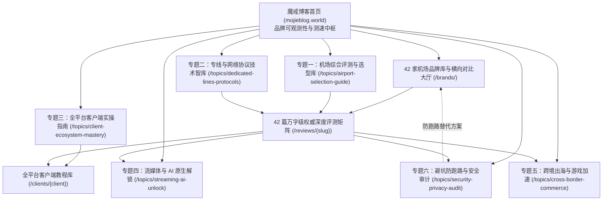

# 魔戒博客 (mojieblog.world) 六大专题 10×10×10 蜂巢内链拓扑蓝图与 6000 篇 SEO 规划矩阵

> **架构目标**：构建以 Google/Bing SEO 与 GEO（生成式搜索优化，如 ChatGPT Search, Perplexity）为核心目标的行业顶级知识图谱与流量转化蜂巢。
> **拓扑原则**：一级导航全网定位 → 60 个二级专题互斥无互抢 → 600 个三级内容集群精准意图锁定 → 6000 篇长尾 SEO 标题蜂巢自洽。

---

## 一、系统架构总览

魔戒博客采用**“一级导航中枢 → 二级专题支柱 → 三级长尾蜂巢”**的非对称多层路由体系。在物理 URL 上，使用**语义化抗 AI 指纹规范**（深度不超过 2 层），但在逻辑内链上，构建完整的双向权威权重流转。

---

## 二、六大专题 10×10 蜂巢结构全景清单

### 专题 1：机场综合评测与品牌库 (airport-selection-guide)

- **定位简述**：42家主流机场多维度横向评测，涵盖2026最新实测晚高峰延迟、带宽吞吐、丢包率与退款政策透明度。
- **支柱页路径**：[`/topics/airport-selection-guide`](/topics/airport-selection-guide)
- **下辖 10 个二级专题与 100 个三级集群**：

#### 1.1 高性价比与平民月付机场 (`budget-airports`)

| 序号 | 三级内容集群 (Cluster) | 搜索意图 (Search Intent) | 蜂巢内链关联锚点 |
| :---: | :--- | :--- | :--- |
| 1 | **5元至10元入门月付精选** | 强决策 / 痛点排查 | [机场综合评测与品牌库 支柱页](/topics/airport-selection-guide) · [品牌库](/brands/) |
| 2 | **年付折合8元以内实测梯队** | 强决策 / 痛点排查 | [机场综合评测与品牌库 支柱页](/topics/airport-selection-guide) · [品牌库](/brands/) |
| 3 | **学生党轻量日常查资料推荐** | 强决策 / 痛点排查 | [机场综合评测与品牌库 支柱页](/topics/airport-selection-guide) · [品牌库](/brands/) |
| 4 | **大流量低倍率平价服务商** | 强决策 / 痛点排查 | [机场综合评测与品牌库 支柱页](/topics/airport-selection-guide) · [品牌库](/brands/) |
| 5 | **不限时一次性流量包对比** | 强决策 / 痛点排查 | [机场综合评测与品牌库 支柱页](/topics/airport-selection-guide) · [品牌库](/brands/) |
| 6 | **多设备无限制共享型低价套餐** | 强决策 / 痛点排查 | [机场综合评测与品牌库 支柱页](/topics/airport-selection-guide) · [品牌库](/brands/) |
| 7 | **月付灵活试错防跑路方案** | 强决策 / 痛点排查 | [机场综合评测与品牌库 支柱页](/topics/airport-selection-guide) · [品牌库](/brands/) |
| 8 | **平民机场晚高峰卡顿归因** | 强决策 / 痛点排查 | [机场综合评测与品牌库 支柱页](/topics/airport-selection-guide) · [品牌库](/brands/) |
| 9 | **平价机场自研客户端体验** | 强决策 / 痛点排查 | [机场综合评测与品牌库 支柱页](/topics/airport-selection-guide) · [品牌库](/brands/) |
| 10 | **低价套餐优惠码与折扣周期** | 强决策 / 痛点排查 | [机场综合评测与品牌库 支柱页](/topics/airport-selection-guide) · [品牌库](/brands/) |

#### 1.2 企业级 IPLC/IEPL 顶级专线机场 (`dedicated-line-airports`)

| 序号 | 三级内容集群 (Cluster) | 搜索意图 (Search Intent) | 蜂巢内链关联锚点 |
| :---: | :--- | :--- | :--- |
| 1 | **全内网专线不过公网防火墙** | 强决策 / 痛点排查 | [机场综合评测与品牌库 支柱页](/topics/airport-selection-guide) · [品牌库](/brands/) |
| 2 | **广州香港/上海日本BGP专线** | 强决策 / 痛点排查 | [机场综合评测与品牌库 支柱页](/topics/airport-selection-guide) · [品牌库](/brands/) |
| 3 | **金融级超低抖动与零丢包实测** | 强决策 / 痛点排查 | [机场综合评测与品牌库 支柱页](/topics/airport-selection-guide) · [品牌库](/brands/) |
| 4 | **敏感时期高可用容灾与备用通道** | 强决策 / 痛点排查 | [机场综合评测与品牌库 支柱页](/topics/airport-selection-guide) · [品牌库](/brands/) |
| 5 | **晚高峰4K/8K秒开高带宽服务** | 强决策 / 痛点排查 | [机场综合评测与品牌库 支柱页](/topics/airport-selection-guide) · [品牌库](/brands/) |
| 6 | **高价专线与低价中转真伪辨识** | 强决策 / 痛点排查 | [机场综合评测与品牌库 支柱页](/topics/airport-selection-guide) · [品牌库](/brands/) |
| 7 | **专线机场倍率计算与真实单价** | 强决策 / 痛点排查 | [机场综合评测与品牌库 支柱页](/topics/airport-selection-guide) · [品牌库](/brands/) |
| 8 | **跨境企业内网访问专用节点** | 强决策 / 痛点排查 | [机场综合评测与品牌库 支柱页](/topics/airport-selection-guide) · [品牌库](/brands/) |
| 9 | **顶级专线机场退款与SLA承诺** | 强决策 / 痛点排查 | [机场综合评测与品牌库 支柱页](/topics/airport-selection-guide) · [品牌库](/brands/) |
| 10 | **独享原生IP与定制专线方案** | 强决策 / 痛点排查 | [机场综合评测与品牌库 支柱页](/topics/airport-selection-guide) · [品牌库](/brands/) |

#### 1.3 新手免配置与一键式专属客户端 (`newbie-friendly`)

| 序号 | 三级内容集群 (Cluster) | 搜索意图 (Search Intent) | 蜂巢内链关联锚点 |
| :---: | :--- | :--- | :--- |
| 1 | **下载登录即用傻瓜式机场** | 强决策 / 痛点排查 | [机场综合评测与品牌库 支柱页](/topics/airport-selection-guide) · [品牌库](/brands/) |
| 2 | **无需提取配置YAML的极简软件** | 强决策 / 痛点排查 | [机场综合评测与品牌库 支柱页](/topics/airport-selection-guide) · [品牌库](/brands/) |
| 3 | **中老年与非技术用户入门指引** | 强决策 / 痛点排查 | [机场综合评测与品牌库 支柱页](/topics/airport-selection-guide) · [品牌库](/brands/) |
| 4 | **专属客户端内置节点故障自检** | 强决策 / 痛点排查 | [机场综合评测与品牌库 支柱页](/topics/airport-selection-guide) · [品牌库](/brands/) |
| 5 | **官方真人7x24小时工单响应** | 强决策 / 痛点排查 | [机场综合评测与品牌库 支柱页](/topics/airport-selection-guide) · [品牌库](/brands/) |
| 6 | **新手常见连接超时与证书报错** | 强决策 / 痛点排查 | [机场综合评测与品牌库 支柱页](/topics/airport-selection-guide) · [品牌库](/brands/) |
| 7 | **从自研客户端向通用客户端过渡** | 强决策 / 痛点排查 | [机场综合评测与品牌库 支柱页](/topics/airport-selection-guide) · [品牌库](/brands/) |
| 8 | **苹果免海外ID的专属下载流程** | 强决策 / 痛点排查 | [机场综合评测与品牌库 支柱页](/topics/airport-selection-guide) · [品牌库](/brands/) |
| 9 | **一键加速开关与智能分流预设** | 强决策 / 痛点排查 | [机场综合评测与品牌库 支柱页](/topics/airport-selection-guide) · [品牌库](/brands/) |
| 10 | **新手月付小额试用避坑手册** | 强决策 / 痛点排查 | [机场综合评测与品牌库 支柱页](/topics/airport-selection-guide) · [品牌库](/brands/) |

#### 1.4 大流量下载与重度媒体消费 (`high-traffic-users`)

| 序号 | 三级内容集群 (Cluster) | 搜索意图 (Search Intent) | 蜂巢内链关联锚点 |
| :---: | :--- | :--- | :--- |
| 1 | **每月1TB至2TB超大配额机场** | 强决策 / 痛点排查 | [机场综合评测与品牌库 支柱页](/topics/airport-selection-guide) · [品牌库](/brands/) |
| 2 | **BT下载与PT下载专用免审计节点** | 强决策 / 痛点排查 | [机场综合评测与品牌库 支柱页](/topics/airport-selection-guide) · [品牌库](/brands/) |
| 3 | **高速网盘同步与大文件传输** | 强决策 / 痛点排查 | [机场综合评测与品牌库 支柱页](/topics/airport-selection-guide) · [品牌库](/brands/) |
| 4 | **家庭影院Infuse挂载NAS播放** | 强决策 / 痛点排查 | [机场综合评测与品牌库 支柱页](/topics/airport-selection-guide) · [品牌库](/brands/) |
| 5 | **海外4K HDR全天候无压测速** | 强决策 / 痛点排查 | [机场综合评测与品牌库 支柱页](/topics/airport-selection-guide) · [品牌库](/brands/) |
| 6 | **大流量套餐的限速策略与QoS** | 强决策 / 痛点排查 | [机场综合评测与品牌库 支柱页](/topics/airport-selection-guide) · [品牌库](/brands/) |
| 7 | **多线路并发下载负载均衡** | 强决策 / 痛点排查 | [机场综合评测与品牌库 支柱页](/topics/airport-selection-guide) · [品牌库](/brands/) |
| 8 | **深夜闲时低倍率流量利用技巧** | 强决策 / 痛点排查 | [机场综合评测与品牌库 支柱页](/topics/airport-selection-guide) · [品牌库](/brands/) |
| 9 | **大流量机场流量重置日注意事项** | 强决策 / 痛点排查 | [机场综合评测与品牌库 支柱页](/topics/airport-selection-guide) · [品牌库](/brands/) |
| 10 | **不限流量机场的带宽超售真相** | 强决策 / 痛点排查 | [机场综合评测与品牌库 支柱页](/topics/airport-selection-guide) · [品牌库](/brands/) |

#### 1.5 多设备在线与团队工作室协作 (`multi-device-teams`)

| 序号 | 三级内容集群 (Cluster) | 搜索意图 (Search Intent) | 蜂巢内链关联锚点 |
| :---: | :--- | :--- | :--- |
| 1 | **不限同时在线设备数量机场** | 强决策 / 痛点排查 | [机场综合评测与品牌库 支柱页](/topics/airport-selection-guide) · [品牌库](/brands/) |
| 2 | **团队多人共享订阅权限管理** | 强决策 / 痛点排查 | [机场综合评测与品牌库 支柱页](/topics/airport-selection-guide) · [品牌库](/brands/) |
| 3 | **跨境电商工作室多IP分配** | 强决策 / 痛点排查 | [机场综合评测与品牌库 支柱页](/topics/airport-selection-guide) · [品牌库](/brands/) |
| 4 | **家庭全屋软路由+多终端并发** | 强决策 / 痛点排查 | [机场综合评测与品牌库 支柱页](/topics/airport-selection-guide) · [品牌库](/brands/) |
| 5 | **局域网设备IP防关联隔离策略** | 强决策 / 痛点排查 | [机场综合评测与品牌库 支柱页](/topics/airport-selection-guide) · [品牌库](/brands/) |
| 6 | **团队专用高配独立带宽节点** | 强决策 / 痛点排查 | [机场综合评测与品牌库 支柱页](/topics/airport-selection-guide) · [品牌库](/brands/) |
| 7 | **多终端同时跑满带宽稳定性** | 强决策 / 痛点排查 | [机场综合评测与品牌库 支柱页](/topics/airport-selection-guide) · [品牌库](/brands/) |
| 8 | **工作室固定IP防封号方案** | 强决策 / 痛点排查 | [机场综合评测与品牌库 支柱页](/topics/airport-selection-guide) · [品牌库](/brands/) |
| 9 | **团队费用报销与企业发票支持** | 强决策 / 痛点排查 | [机场综合评测与品牌库 支柱页](/topics/airport-selection-guide) · [品牌库](/brands/) |
| 10 | **多人混用导致节点触发风控应对** | 强决策 / 痛点排查 | [机场综合评测与品牌库 支柱页](/topics/airport-selection-guide) · [品牌库](/brands/) |

#### 1.6 全球冷门国家与小众节点覆盖 (`global-node-coverage`)

| 序号 | 三级内容集群 (Cluster) | 搜索意图 (Search Intent) | 蜂巢内链关联锚点 |
| :---: | :--- | :--- | :--- |
| 1 | **欧洲/南美/中东冷门节点全集** | 强决策 / 痛点排查 | [机场综合评测与品牌库 支柱页](/topics/airport-selection-guide) · [品牌库](/brands/) |
| 2 | **阿根廷/土耳其/埃及低价区节点** | 强决策 / 痛点排查 | [机场综合评测与品牌库 支柱页](/topics/airport-selection-guide) · [品牌库](/brands/) |
| 3 | **跨国爬虫采集全球多点部署** | 强决策 / 痛点排查 | [机场综合评测与品牌库 支柱页](/topics/airport-selection-guide) · [品牌库](/brands/) |
| 4 | **冷门地区原生住宅IP真伪测试** | 强决策 / 痛点排查 | [机场综合评测与品牌库 支柱页](/topics/airport-selection-guide) · [品牌库](/brands/) |
| 5 | **国际漫游长距离延迟物理限制** | 强决策 / 痛点排查 | [机场综合评测与品牌库 支柱页](/topics/airport-selection-guide) · [品牌库](/brands/) |
| 6 | **冷门节点维护频次与在线率** | 强决策 / 痛点排查 | [机场综合评测与品牌库 支柱页](/topics/airport-selection-guide) · [品牌库](/brands/) |
| 7 | **全球环网拓扑与多级跳板分析** | 强决策 / 痛点排查 | [机场综合评测与品牌库 支柱页](/topics/airport-selection-guide) · [品牌库](/brands/) |
| 8 | **东南亚本土电商低延迟节点** | 强决策 / 痛点排查 | [机场综合评测与品牌库 支柱页](/topics/airport-selection-guide) · [品牌库](/brands/) |
| 9 | **非洲及大洋洲节点稀缺度解析** | 强决策 / 痛点排查 | [机场综合评测与品牌库 支柱页](/topics/airport-selection-guide) · [品牌库](/brands/) |
| 10 | **动态IP轮换与多国代理池联动** | 强决策 / 痛点排查 | [机场综合评测与品牌库 支柱页](/topics/airport-selection-guide) · [品牌库](/brands/) |

#### 1.7 运营3年以上老牌稳定机场 (`old-established-brands`)

| 序号 | 三级内容集群 (Cluster) | 搜索意图 (Search Intent) | 蜂巢内链关联锚点 |
| :---: | :--- | :--- | :--- |
| 1 | **老牌机场运营历史与信誉背书** | 强决策 / 痛点排查 | [机场综合评测与品牌库 支柱页](/topics/airport-selection-guide) · [品牌库](/brands/) |
| 2 | **穿越多次重大封锁的防封实力** | 强决策 / 痛点排查 | [机场综合评测与品牌库 支柱页](/topics/airport-selection-guide) · [品牌库](/brands/) |
| 3 | **老牌服务商技术团队背景与实力** | 强决策 / 痛点排查 | [机场综合评测与品牌库 支柱页](/topics/airport-selection-guide) · [品牌库](/brands/) |
| 4 | **老牌机场线路储备与冗余方案** | 强决策 / 痛点排查 | [机场综合评测与品牌库 支柱页](/topics/airport-selection-guide) · [品牌库](/brands/) |
| 5 | **高留存率背后的客服与运维文化** | 强决策 / 痛点排查 | [机场综合评测与品牌库 支柱页](/topics/airport-selection-guide) · [品牌库](/brands/) |
| 6 | **老牌机场涨价周期与套餐演变** | 强决策 / 痛点排查 | [机场综合评测与品牌库 支柱页](/topics/airport-selection-guide) · [品牌库](/brands/) |
| 7 | **老牌大厂对灰产与DDOS防御能力** | 强决策 / 痛点排查 | [机场综合评测与品牌库 支柱页](/topics/airport-selection-guide) · [品牌库](/brands/) |
| 8 | **老牌服务商Telegram频道生态** | 强决策 / 痛点排查 | [机场综合评测与品牌库 支柱页](/topics/airport-selection-guide) · [品牌库](/brands/) |
| 9 | **老牌机场年付续费保价权益** | 强决策 / 痛点排查 | [机场综合评测与品牌库 支柱页](/topics/airport-selection-guide) · [品牌库](/brands/) |
| 10 | **老牌与新兴机场技术迭代对比** | 强决策 / 痛点排查 | [机场综合评测与品牌库 支柱页](/topics/airport-selection-guide) · [品牌库](/brands/) |

#### 1.8 支付方式多样性与隐私保护 (`payment-convenience`)

| 序号 | 三级内容集群 (Cluster) | 搜索意图 (Search Intent) | 蜂巢内链关联锚点 |
| :---: | :--- | :--- | :--- |
| 1 | **支持微信/支付宝国内直付机场** | 强决策 / 痛点排查 | [机场综合评测与品牌库 支柱页](/topics/airport-selection-guide) · [品牌库](/brands/) |
| 2 | **USDT/TRC20加密货币匿名结算** | 强决策 / 痛点排查 | [机场综合评测与品牌库 支柱页](/topics/airport-selection-guide) · [品牌库](/brands/) |
| 3 | **信用卡与PayPal海外结算渠道** | 强决策 / 痛点排查 | [机场综合评测与品牌库 支柱页](/topics/airport-selection-guide) · [品牌库](/brands/) |
| 4 | **支付通道风控报错与代付风险** | 强决策 / 痛点排查 | [机场综合评测与品牌库 支柱页](/topics/airport-selection-guide) · [品牌库](/brands/) |
| 5 | **人民币自动汇率结算与手续费** | 强决策 / 痛点排查 | [机场综合评测与品牌库 支柱页](/topics/airport-selection-guide) · [品牌库](/brands/) |
| 6 | **匿名邮箱与一次性虚拟币支付** | 强决策 / 痛点排查 | [机场综合评测与品牌库 支柱页](/topics/airport-selection-guide) · [品牌库](/brands/) |
| 7 | **支付网关隐私泄露防范建议** | 强决策 / 痛点排查 | [机场综合评测与品牌库 支柱页](/topics/airport-selection-guide) · [品牌库](/brands/) |
| 8 | **未到账工单提交与订单恢复机制** | 强决策 / 痛点排查 | [机场综合评测与品牌库 支柱页](/topics/airport-selection-guide) · [品牌库](/brands/) |
| 9 | **周期自动扣款取消与解绑指南** | 强决策 / 痛点排查 | [机场综合评测与品牌库 支柱页](/topics/airport-selection-guide) · [品牌库](/brands/) |
| 10 | **促销活动满减与返还到账户余额** | 强决策 / 痛点排查 | [机场综合评测与品牌库 支柱页](/topics/airport-selection-guide) · [品牌库](/brands/) |

#### 1.9 电竞外服联机与极低延迟节点 (`gaming-latency-focus`)

| 序号 | 三级内容集群 (Cluster) | 搜索意图 (Search Intent) | 蜂巢内链关联锚点 |
| :---: | :--- | :--- | :--- |
| 1 | **Apex/COD/战地外服低丢包节点** | 强决策 / 痛点排查 | [机场综合评测与品牌库 支柱页](/topics/airport-selection-guide) · [品牌库](/brands/) |
| 2 | **日韩服务器延迟20ms极速直连** | 强决策 / 痛点排查 | [机场综合评测与品牌库 支柱页](/topics/airport-selection-guide) · [品牌库](/brands/) |
| 3 | **UDP Full-Cone NAT类型实测** | 强决策 / 痛点排查 | [机场综合评测与品牌库 支柱页](/topics/airport-selection-guide) · [品牌库](/brands/) |
| 4 | **游戏节点防丢包与抖动抑制算法** | 强决策 / 痛点排查 | [机场综合评测与品牌库 支柱页](/topics/airport-selection-guide) · [品牌库](/brands/) |
| 5 | **主机Switch/PS5/Xbox代理加速** | 强决策 / 痛点排查 | [机场综合评测与品牌库 支柱页](/topics/airport-selection-guide) · [品牌库](/brands/) |
| 6 | **游戏分流规则与语音Discord直连** | 强决策 / 痛点排查 | [机场综合评测与品牌库 支柱页](/topics/airport-selection-guide) · [品牌库](/brands/) |
| 7 | **普通机场与专业游戏加速器差异** | 强决策 / 痛点排查 | [机场综合评测与品牌库 支柱页](/topics/airport-selection-guide) · [品牌库](/brands/) |
| 8 | **Steam/Epic跨区下载提速方案** | 强决策 / 痛点排查 | [机场综合评测与品牌库 支柱页](/topics/airport-selection-guide) · [品牌库](/brands/) |
| 9 | **晚高峰电竞赛事网络抗干扰能力** | 强决策 / 痛点排查 | [机场综合评测与品牌库 支柱页](/topics/airport-selection-guide) · [品牌库](/brands/) |
| 10 | **游戏公会跨国开黑专线自建建议** | 强决策 / 痛点排查 | [机场综合评测与品牌库 支柱页](/topics/airport-selection-guide) · [品牌库](/brands/) |

#### 1.10 备用容灾与双机场双活组合 (`disaster-recovery-backup`)

| 序号 | 三级内容集群 (Cluster) | 搜索意图 (Search Intent) | 蜂巢内链关联锚点 |
| :---: | :--- | :--- | :--- |
| 1 | **主备双机场自动故障转移策略** | 强决策 / 痛点排查 | [机场综合评测与品牌库 支柱页](/topics/airport-selection-guide) · [品牌库](/brands/) |
| 2 | **专线大厂+低价轻量双活组合** | 强决策 / 痛点排查 | [机场综合评测与品牌库 支柱页](/topics/airport-selection-guide) · [品牌库](/brands/) |
| 3 | **Clash策略组Fallback自动切换** | 强决策 / 痛点排查 | [机场综合评测与品牌库 支柱页](/topics/airport-selection-guide) · [品牌库](/brands/) |
| 4 | **突发断网5分钟应急抢修指南** | 强决策 / 痛点排查 | [机场综合评测与品牌库 支柱页](/topics/airport-selection-guide) · [品牌库](/brands/) |
| 5 | **多机场订阅本地聚合与去重** | 强决策 / 痛点排查 | [机场综合评测与品牌库 支柱页](/topics/airport-selection-guide) · [品牌库](/brands/) |
| 6 | **本地DNS污染与节点全部超时排查** | 强决策 / 痛点排查 | [机场综合评测与品牌库 支柱页](/topics/airport-selection-guide) · [品牌库](/brands/) |
| 7 | **备用节点永久有效免费备用池** | 强决策 / 痛点排查 | [机场综合评测与品牌库 支柱页](/topics/airport-selection-guide) · [品牌库](/brands/) |
| 8 | **机场服务商上游机房故障监控** | 强决策 / 痛点排查 | [机场综合评测与品牌库 支柱页](/topics/airport-selection-guide) · [品牌库](/brands/) |
| 9 | **高危敏感期节点快速保活策略** | 强决策 / 痛点排查 | [机场综合评测与品牌库 支柱页](/topics/airport-selection-guide) · [品牌库](/brands/) |
| 10 | **跨协议备用通道（VLESS+Hysteria）** | 强决策 / 痛点排查 | [机场综合评测与品牌库 支柱页](/topics/airport-selection-guide) · [品牌库](/brands/) |

### 专题 2：专线与网络协议技术智库 (dedicated-lines-protocols)

- **定位简述**：从底层物理光缆到应用层加密：深入解剖 IPLC/IEPL、BGP 智能中转、VLESS-Reality、Hysteria 2、TUIC 与 Trojan。
- **支柱页路径**：[`/topics/dedicated-lines-protocols`](/topics/dedicated-lines-protocols)
- **下辖 10 个二级专题与 100 个三级集群**：

#### 2.1 IPLC 与 IEPL 跨境专线技术全解 (`iplc-vs-iepl`)

| 序号 | 三级内容集群 (Cluster) | 搜索意图 (Search Intent) | 蜂巢内链关联锚点 |
| :---: | :--- | :--- | :--- |
| 1 | **IPLC局域网互联原理与优势** | 强决策 / 痛点排查 | [专线与网络协议技术智库 支柱页](/topics/dedicated-lines-protocols) · [品牌库](/brands/) |
| 2 | **IEPL以太网专线与QoS保障等级** | 强决策 / 痛点排查 | [专线与网络协议技术智库 支柱页](/topics/dedicated-lines-protocols) · [品牌库](/brands/) |
| 3 | **专线不过GFW长城防火墙物理机制** | 强决策 / 痛点排查 | [专线与网络协议技术智库 支柱页](/topics/dedicated-lines-protocols) · [品牌库](/brands/) |
| 4 | **专线跨境入口BGP多线接入** | 强决策 / 痛点排查 | [专线与网络协议技术智库 支柱页](/topics/dedicated-lines-protocols) · [品牌库](/brands/) |
| 5 | **专线单点故障时的机房备用路由** | 强决策 / 痛点排查 | [专线与网络协议技术智库 支柱页](/topics/dedicated-lines-protocols) · [品牌库](/brands/) |
| 6 | **专线带宽成本与机场真实定价模型** | 强决策 / 痛点排查 | [专线与网络协议技术智库 支柱页](/topics/dedicated-lines-protocols) · [品牌库](/brands/) |
| 7 | **点对点专线与多点环网专线拓扑** | 强决策 / 痛点排查 | [专线与网络协议技术智库 支柱页](/topics/dedicated-lines-protocols) · [品牌库](/brands/) |
| 8 | **专线抖动(Jitter)与丢包率(Packet Loss)** | 强决策 / 痛点排查 | [专线与网络协议技术智库 支柱页](/topics/dedicated-lines-protocols) · [品牌库](/brands/) |
| 9 | **假专线（公网中转伪装）检测工具** | 强决策 / 痛点排查 | [专线与网络协议技术智库 支柱页](/topics/dedicated-lines-protocols) · [品牌库](/brands/) |
| 10 | **海缆中断对专线延迟的真实影响** | 强决策 / 痛点排查 | [专线与网络协议技术智库 支柱页](/topics/dedicated-lines-protocols) · [品牌库](/brands/) |

#### 2.2 BGP 中继与公网隧道技术 (`bgp-tunnel-transit`)

| 序号 | 三级内容集群 (Cluster) | 搜索意图 (Search Intent) | 蜂巢内链关联锚点 |
| :---: | :--- | :--- | :--- |
| 1 | **国内BGP多线入口智能调度逻辑** | 强决策 / 痛点排查 | [专线与网络协议技术智库 支柱页](/topics/dedicated-lines-protocols) · [品牌库](/brands/) |
| 2 | **三网（电信联通移动）最佳接入点** | 强决策 / 痛点排查 | [专线与网络协议技术智库 支柱页](/topics/dedicated-lines-protocols) · [品牌库](/brands/) |
| 3 | **国内中转机房到海外落地隧道传输** | 强决策 / 痛点排查 | [专线与网络协议技术智库 支柱页](/topics/dedicated-lines-protocols) · [品牌库](/brands/) |
| 4 | **GOST/Ehco/TLS隧道加密开销** | 强决策 / 痛点排查 | [专线与网络协议技术智库 支柱页](/topics/dedicated-lines-protocols) · [品牌库](/brands/) |
| 5 | **公网中转与专线的本质性能分水岭** | 强决策 / 痛点排查 | [专线与网络协议技术智库 支柱页](/topics/dedicated-lines-protocols) · [品牌库](/brands/) |
| 6 | **中转机房被攻击时的流量切换机制** | 强决策 / 痛点排查 | [专线与网络协议技术智库 支柱页](/topics/dedicated-lines-protocols) · [品牌库](/brands/) |
| 7 | **晚高峰骨干网QoS拥堵机制** | 强决策 / 痛点排查 | [专线与网络协议技术智库 支柱页](/topics/dedicated-lines-protocols) · [品牌库](/brands/) |
| 8 | **移动宽带快乐机与联通直连优势** | 强决策 / 痛点排查 | [专线与网络协议技术智库 支柱页](/topics/dedicated-lines-protocols) · [品牌库](/brands/) |
| 9 | **自建中转隧道与商用机场中转对比** | 强决策 / 痛点排查 | [专线与网络协议技术智库 支柱页](/topics/dedicated-lines-protocols) · [品牌库](/brands/) |
| 10 | **多入口多出口动态负载均衡算法** | 强决策 / 痛点排查 | [专线与网络协议技术智库 支柱页](/topics/dedicated-lines-protocols) · [品牌库](/brands/) |

#### 2.3 VLESS 协议与 Reality 伪装机制 (`vless-reality-deep-dive`)

| 序号 | 三级内容集群 (Cluster) | 搜索意图 (Search Intent) | 蜂巢内链关联锚点 |
| :---: | :--- | :--- | :--- |
| 1 | **VLESS协议相比VMess去冗余优势** | 强决策 / 痛点排查 | [专线与网络协议技术智库 支柱页](/topics/dedicated-lines-protocols) · [品牌库](/brands/) |
| 2 | **Reality技术无需自备域名原理** | 强决策 / 痛点排查 | [专线与网络协议技术智库 支柱页](/topics/dedicated-lines-protocols) · [品牌库](/brands/) |
| 3 | **借用海外大型网站公钥与证书指纹** | 强决策 / 痛点排查 | [专线与网络协议技术智库 支柱页](/topics/dedicated-lines-protocols) · [品牌库](/brands/) |
| 4 | **TLS Client Hello与主动探测免疫** | 强决策 / 痛点排查 | [专线与网络协议技术智库 支柱页](/topics/dedicated-lines-protocols) · [品牌库](/brands/) |
| 5 | **uTLS指纹模拟防审查识别** | 强决策 / 痛点排查 | [专线与网络协议技术智库 支柱页](/topics/dedicated-lines-protocols) · [品牌库](/brands/) |
| 6 | **Reality常见偷取目标网站挑选准则** | 强决策 / 痛点排查 | [专线与网络协议技术智库 支柱页](/topics/dedicated-lines-protocols) · [品牌库](/brands/) |
| 7 | **Reality在抗封锁时期的存活率实测** | 强决策 / 痛点排查 | [专线与网络协议技术智库 支柱页](/topics/dedicated-lines-protocols) · [品牌库](/brands/) |
| 8 | **服务端与客户端公私钥配置规范** | 强决策 / 痛点排查 | [专线与网络协议技术智库 支柱页](/topics/dedicated-lines-protocols) · [品牌库](/brands/) |
| 9 | **Reality延迟开销与加解密CPU占用** | 强决策 / 痛点排查 | [专线与网络协议技术智库 支柱页](/topics/dedicated-lines-protocols) · [品牌库](/brands/) |
| 10 | **VLESS gRPC与WebSocket传输模式对比** | 强决策 / 痛点排查 | [专线与网络协议技术智库 支柱页](/topics/dedicated-lines-protocols) · [品牌库](/brands/) |

#### 2.4 基于 UDP 的 Hysteria 2 与 TUIC (`hysteria2-tuic`)

| 序号 | 三级内容集群 (Cluster) | 搜索意图 (Search Intent) | 蜂巢内链关联锚点 |
| :---: | :--- | :--- | :--- |
| 1 | **QUIC协议在弱网高丢包下的突破** | 强决策 / 痛点排查 | [专线与网络协议技术智库 支柱页](/topics/dedicated-lines-protocols) · [品牌库](/brands/) |
| 2 | **Hysteria 2暴力拥塞控制算法Brutal** | 强决策 / 痛点排查 | [专线与网络协议技术智库 支柱页](/topics/dedicated-lines-protocols) · [品牌库](/brands/) |
| 3 | **TUIC与QUIC原生多路复用优势** | 强决策 / 痛点排查 | [专线与网络协议技术智库 支柱页](/topics/dedicated-lines-protocols) · [品牌库](/brands/) |
| 4 | **运营商对UDP端口QoS恶劣限速应对** | 强决策 / 痛点排查 | [专线与网络协议技术智库 支柱页](/topics/dedicated-lines-protocols) · [品牌库](/brands/) |
| 5 | **丢包率30%环境下吞吐量实测** | 强决策 / 痛点排查 | [专线与网络协议技术智库 支柱页](/topics/dedicated-lines-protocols) · [品牌库](/brands/) |
| 6 | **UDP垃圾流量特征与GFW拦截几率** | 强决策 / 痛点排查 | [专线与网络协议技术智库 支柱页](/topics/dedicated-lines-protocols) · [品牌库](/brands/) |
| 7 | **移动端省电表现与断网重连速度** | 强决策 / 痛点排查 | [专线与网络协议技术智库 支柱页](/topics/dedicated-lines-protocols) · [品牌库](/brands/) |
| 8 | **服务端端口跳跃(Port Hopping)防封** | 强决策 / 痛点排查 | [专线与网络协议技术智库 支柱页](/topics/dedicated-lines-protocols) · [品牌库](/brands/) |
| 9 | **Hysteria 2在4K视频缓冲中的爆发力** | 强决策 / 痛点排查 | [专线与网络协议技术智库 支柱页](/topics/dedicated-lines-protocols) · [品牌库](/brands/) |
| 10 | **UDP代理与TCP代理并行的策略配置** | 强决策 / 痛点排查 | [专线与网络协议技术智库 支柱页](/topics/dedicated-lines-protocols) · [品牌库](/brands/) |

#### 2.5 Trojan 与经典 Shadowsocks 协议 (`trojan-shadowsocks`)

| 序号 | 三级内容集群 (Cluster) | 搜索意图 (Search Intent) | 蜂巢内链关联锚点 |
| :---: | :--- | :--- | :--- |
| 1 | **Trojan模拟标准HTTPS流量防探测** | 强决策 / 痛点排查 | [专线与网络协议技术智库 支柱页](/topics/dedicated-lines-protocols) · [品牌库](/brands/) |
| 2 | **真实域名与Let's Encrypt证书配置** | 强决策 / 痛点排查 | [专线与网络协议技术智库 支柱页](/topics/dedicated-lines-protocols) · [品牌库](/brands/) |
| 3 | **Shadowsocks 2022新规范与AEAD加密** | 强决策 / 痛点排查 | [专线与网络协议技术智库 支柱页](/topics/dedicated-lines-protocols) · [品牌库](/brands/) |
| 4 | **经典SS特征识别历史与封锁演进** | 强决策 / 痛点排查 | [专线与网络协议技术智库 支柱页](/topics/dedicated-lines-protocols) · [品牌库](/brands/) |
| 5 | **Trojan-Go多路复用与Websocket回落** | 强决策 / 痛点排查 | [专线与网络协议技术智库 支柱页](/topics/dedicated-lines-protocols) · [品牌库](/brands/) |
| 6 | **嵌入式设备与老旧路由器低功耗首选** | 强决策 / 痛点排查 | [专线与网络协议技术智库 支柱页](/topics/dedicated-lines-protocols) · [品牌库](/brands/) |
| 7 | **Trojan与VLESS伪装效果横向比较** | 强决策 / 痛点排查 | [专线与网络协议技术智库 支柱页](/topics/dedicated-lines-protocols) · [品牌库](/brands/) |
| 8 | **企业防火墙对Trojan流量的深层检测** | 强决策 / 痛点排查 | [专线与网络协议技术智库 支柱页](/topics/dedicated-lines-protocols) · [品牌库](/brands/) |
| 9 | **SS-Rust高性能多线程服务端部署** | 强决策 / 痛点排查 | [专线与网络协议技术智库 支柱页](/topics/dedicated-lines-protocols) · [品牌库](/brands/) |
| 10 | **经典协议在专线环境下的高效利用** | 强决策 / 痛点排查 | [专线与网络协议技术智库 支柱页](/topics/dedicated-lines-protocols) · [品牌库](/brands/) |

#### 2.6 全球 ASN、BGP 路由与海缆拓扑 (`asn-bgp-routing`)

| 序号 | 三级内容集群 (Cluster) | 搜索意图 (Search Intent) | 蜂巢内链关联锚点 |
| :---: | :--- | :--- | :--- |
| 1 | **中国电信163骨干网与CN2 GIA/GT** | 强决策 / 痛点排查 | [专线与网络协议技术智库 支柱页](/topics/dedicated-lines-protocols) · [品牌库](/brands/) |
| 2 | **中国联通169骨干网与9929/AS4837** | 强决策 / 痛点排查 | [专线与网络协议技术智库 支柱页](/topics/dedicated-lines-protocols) · [品牌库](/brands/) |
| 3 | **中国移动CMI跨境出口带宽优势** | 强决策 / 痛点排查 | [专线与网络协议技术智库 支柱页](/topics/dedicated-lines-protocols) · [品牌库](/brands/) |
| 4 | **太平洋APG/NCP/TPE海缆走向与延迟** | 强决策 / 痛点排查 | [专线与网络协议技术智库 支柱页](/topics/dedicated-lines-protocols) · [品牌库](/brands/) |
| 5 | **欧洲路线中欧陆缆与亚欧海缆对比** | 强决策 / 痛点排查 | [专线与网络协议技术智库 支柱页](/topics/dedicated-lines-protocols) · [品牌库](/brands/) |
| 6 | **Looking Glass路由追踪与MTR测速** | 强决策 / 痛点排查 | [专线与网络协议技术智库 支柱页](/topics/dedicated-lines-protocols) · [品牌库](/brands/) |
| 7 | **BGP Anycast技术在节点分发中的应用** | 强决策 / 痛点排查 | [专线与网络协议技术智库 支柱页](/topics/dedicated-lines-protocols) · [品牌库](/brands/) |
| 8 | **直连回国路由与绕美绕欧死穴排查** | 强决策 / 痛点排查 | [专线与网络协议技术智库 支柱页](/topics/dedicated-lines-protocols) · [品牌库](/brands/) |
| 9 | **云厂商骨干网（AWS/GCP/Azure/Cloudflare）** | 强决策 / 痛点排查 | [专线与网络协议技术智库 支柱页](/topics/dedicated-lines-protocols) · [品牌库](/brands/) |
| 10 | **ASN自治系统号对节点归属地查询** | 强决策 / 痛点排查 | [专线与网络协议技术智库 支柱页](/topics/dedicated-lines-protocols) · [品牌库](/brands/) |

#### 2.7 加密算法、传输损耗与性能调优 (`encryption-overhead`)

| 序号 | 三级内容集群 (Cluster) | 搜索意图 (Search Intent) | 蜂巢内链关联锚点 |
| :---: | :--- | :--- | :--- |
| 1 | **AES-128-GCM与ChaCha20-Poly1305能效** | 强决策 / 痛点排查 | [专线与网络协议技术智库 支柱页](/topics/dedicated-lines-protocols) · [品牌库](/brands/) |
| 2 | **ARM架构设备硬件加密加速指令集** | 强决策 / 痛点排查 | [专线与网络协议技术智库 支柱页](/topics/dedicated-lines-protocols) · [品牌库](/brands/) |
| 3 | **TLS 1.3握手轮次优化与0-RTT风险** | 强决策 / 痛点排查 | [专线与网络协议技术智库 支柱页](/topics/dedicated-lines-protocols) · [品牌库](/brands/) |
| 4 | **TCP BBR拥塞控制算法原理与实战** | 强决策 / 痛点排查 | [专线与网络协议技术智库 支柱页](/topics/dedicated-lines-protocols) · [品牌库](/brands/) |
| 5 | **MTU与MSS分片导致的丢包卡顿调优** | 强决策 / 痛点排查 | [专线与网络协议技术智库 支柱页](/topics/dedicated-lines-protocols) · [品牌库](/brands/) |
| 6 | **TCP Fast Open开启条件与兼容性** | 强决策 / 痛点排查 | [专线与网络协议技术智库 支柱页](/topics/dedicated-lines-protocols) · [品牌库](/brands/) |
| 7 | **多路复用(Mux)在延迟与带宽间的权衡** | 强决策 / 痛点排查 | [专线与网络协议技术智库 支柱页](/topics/dedicated-lines-protocols) · [品牌库](/brands/) |
| 8 | **CPU占用率对千兆并发速度的制约** | 强决策 / 痛点排查 | [专线与网络协议技术智库 支柱页](/topics/dedicated-lines-protocols) · [品牌库](/brands/) |
| 9 | **内存泄漏与长时间运行缓存释放** | 强决策 / 痛点排查 | [专线与网络协议技术智库 支柱页](/topics/dedicated-lines-protocols) · [品牌库](/brands/) |
| 10 | **代理客户端系统级网络优化脚本** | 强决策 / 痛点排查 | [专线与网络协议技术智库 支柱页](/topics/dedicated-lines-protocols) · [品牌库](/brands/) |

#### 2.8 IPv6 节点支持与双栈网络优化 (`ipv6-routing`)

| 序号 | 三级内容集群 (Cluster) | 搜索意图 (Search Intent) | 蜂巢内链关联锚点 |
| :---: | :--- | :--- | :--- |
| 1 | **纯IPv6节点的跨境延迟与绕路情况** | 强决策 / 痛点排查 | [专线与网络协议技术智库 支柱页](/topics/dedicated-lines-protocols) · [品牌库](/brands/) |
| 2 | **国内三网IPv6直连海外机房免封锁** | 强决策 / 痛点排查 | [专线与网络协议技术智库 支柱页](/topics/dedicated-lines-protocols) · [品牌库](/brands/) |
| 3 | **IPv4/IPv6双栈分流优先级配置** | 强决策 / 痛点排查 | [专线与网络协议技术智库 支柱页](/topics/dedicated-lines-protocols) · [品牌库](/brands/) |
| 4 | **DNS解析中的AAAA记录泄漏风险** | 强决策 / 痛点排查 | [专线与网络协议技术智库 支柱页](/topics/dedicated-lines-protocols) · [品牌库](/brands/) |
| 5 | **IPv6代理在校园网免流环境的应用** | 强决策 / 痛点排查 | [专线与网络协议技术智库 支柱页](/topics/dedicated-lines-protocols) · [品牌库](/brands/) |
| 6 | **移动5G网络原生IPv6低延迟体验** | 强决策 / 痛点排查 | [专线与网络协议技术智库 支柱页](/topics/dedicated-lines-protocols) · [品牌库](/brands/) |
| 7 | **IPv6对P2P连接与NAT穿透的巨大提升** | 强决策 / 痛点排查 | [专线与网络协议技术智库 支柱页](/topics/dedicated-lines-protocols) · [品牌库](/brands/) |
| 8 | **机场提供纯IPv6节点的实用场景** | 强决策 / 痛点排查 | [专线与网络协议技术智库 支柱页](/topics/dedicated-lines-protocols) · [品牌库](/brands/) |
| 9 | **IPv6地址隐私拓展与设备跟踪防范** | 强决策 / 痛点排查 | [专线与网络协议技术智库 支柱页](/topics/dedicated-lines-protocols) · [品牌库](/brands/) |
| 10 | **软路由IPv6 DDNS与外部访问穿透** | 强决策 / 痛点排查 | [专线与网络协议技术智库 支柱页](/topics/dedicated-lines-protocols) · [品牌库](/brands/) |

#### 2.9 DNS 解析防污染、DoH/DoT 与 ECS (`dns-leak-protection`)

| 序号 | 三级内容集群 (Cluster) | 搜索意图 (Search Intent) | 蜂巢内链关联锚点 |
| :---: | :--- | :--- | :--- |
| 1 | **DNS投毒与GFW伪造响应拦截机制** | 强决策 / 痛点排查 | [专线与网络协议技术智库 支柱页](/topics/dedicated-lines-protocols) · [品牌库](/brands/) |
| 2 | **DoH(DNS-over-HTTPS)与DoT加密实战** | 强决策 / 痛点排查 | [专线与网络协议技术智库 支柱页](/topics/dedicated-lines-protocols) · [品牌库](/brands/) |
| 3 | **Clash中的Fake-IP模式与Mapping原理** | 强决策 / 痛点排查 | [专线与网络协议技术智库 支柱页](/topics/dedicated-lines-protocols) · [品牌库](/brands/) |
| 4 | **Redir-Host传统模式的优劣分析** | 强决策 / 痛点排查 | [专线与网络协议技术智库 支柱页](/topics/dedicated-lines-protocols) · [品牌库](/brands/) |
| 5 | **EDNS Client Subnet(ECS)对CDN的影响** | 强决策 / 痛点排查 | [专线与网络协议技术智库 支柱页](/topics/dedicated-lines-protocols) · [品牌库](/brands/) |
| 6 | **分流规则中GeoIP与GeoSite解析顺序** | 强决策 / 痛点排查 | [专线与网络协议技术智库 支柱页](/topics/dedicated-lines-protocols) · [品牌库](/brands/) |
| 7 | **DNS泄露检测网站与真实IP防护** | 强决策 / 痛点排查 | [专线与网络协议技术智库 支柱页](/topics/dedicated-lines-protocols) · [品牌库](/brands/) |
| 8 | **MOSDNS自建分流与双上游DNS配置** | 强决策 / 痛点排查 | [专线与网络协议技术智库 支柱页](/topics/dedicated-lines-protocols) · [品牌库](/brands/) |
| 9 | **国内域名直连DNS与海外加密DNS分离** | 强决策 / 痛点排查 | [专线与网络协议技术智库 支柱页](/topics/dedicated-lines-protocols) · [品牌库](/brands/) |
| 10 | **AdGuard Home与代理客户端DNS链条整合** | 强决策 / 痛点排查 | [专线与网络协议技术智库 支柱页](/topics/dedicated-lines-protocols) · [品牌库](/brands/) |

#### 2.10 网络可观测性与自动化测试工具 (`network-observability-tools`)

| 序号 | 三级内容集群 (Cluster) | 搜索意图 (Search Intent) | 蜂巢内链关联锚点 |
| :---: | :--- | :--- | :--- |
| 1 | **Speedtest CLI批量压测脚本实战** | 强决策 / 痛点排查 | [专线与网络协议技术智库 支柱页](/topics/dedicated-lines-protocols) · [品牌库](/brands/) |
| 2 | **NextTrace开源可视化路由追踪** | 强决策 / 痛点排查 | [专线与网络协议技术智库 支柱页](/topics/dedicated-lines-protocols) · [品牌库](/brands/) |
| 3 | **RegionRestrictionCheck流媒体检测** | 强决策 / 痛点排查 | [专线与网络协议技术智库 支柱页](/topics/dedicated-lines-protocols) · [品牌库](/brands/) |
| 4 | **MTR持续监测抖动与丢包节点** | 强决策 / 痛点排查 | [专线与网络协议技术智库 支柱页](/topics/dedicated-lines-protocols) · [品牌库](/brands/) |
| 5 | **Grafana+Prometheus机场在线率看板** | 强决策 / 痛点排查 | [专线与网络协议技术智库 支柱页](/topics/dedicated-lines-protocols) · [品牌库](/brands/) |
| 6 | **Wireshark抓包分析代理握手特征** | 强决策 / 痛点排查 | [专线与网络协议技术智库 支柱页](/topics/dedicated-lines-protocols) · [品牌库](/brands/) |
| 7 | **PingPeep全球多地延迟实时监控** | 强决策 / 痛点排查 | [专线与网络协议技术智库 支柱页](/topics/dedicated-lines-protocols) · [品牌库](/brands/) |
| 8 | **自建网络监控机器人Telegram报警** | 强决策 / 痛点排查 | [专线与网络协议技术智库 支柱页](/topics/dedicated-lines-protocols) · [品牌库](/brands/) |
| 9 | **Shadowrocket内置延迟测试准确度剖析** | 强决策 / 痛点排查 | [专线与网络协议技术智库 支柱页](/topics/dedicated-lines-protocols) · [品牌库](/brands/) |
| 10 | **网络丢包率与TCP重传率关系实测** | 强决策 / 痛点排查 | [专线与网络协议技术智库 支柱页](/topics/dedicated-lines-protocols) · [品牌库](/brands/) |

### 专题 3：全平台客户端实操指南 (client-ecosystem-mastery)

- **定位简述**：覆盖 Windows、macOS、iOS、Android、Linux 与软路由的全栈客户端安装、订阅导入、分流规则配置与故障自检。
- **支柱页路径**：[`/topics/client-ecosystem-mastery`](/topics/client-ecosystem-mastery)
- **下辖 10 个二级专题与 100 个三级集群**：

#### 3.1 Clash Verge Rev 核心进阶指南 (`clash-verge-rev`)

| 序号 | 三级内容集群 (Cluster) | 搜索意图 (Search Intent) | 蜂巢内链关联锚点 |
| :---: | :--- | :--- | :--- |
| 1 | **从已弃用CFW无缝迁移至Verge Rev** | 强决策 / 痛点排查 | [全平台客户端实操指南 支柱页](/topics/client-ecosystem-mastery) · [品牌库](/brands/) |
| 2 | **Mihomo内核升级与实验性功能开启** | 强决策 / 痛点排查 | [全平台客户端实操指南 支柱页](/topics/client-ecosystem-mastery) · [品牌库](/brands/) |
| 3 | **TUN虚拟网卡模式接管系统全部流量** | 强决策 / 痛点排查 | [全平台客户端实操指南 支柱页](/topics/client-ecosystem-mastery) · [品牌库](/brands/) |
| 4 | **Script/Merge订阅扩展配置与脚本编写** | 强决策 / 痛点排查 | [全平台客户端实操指南 支柱页](/topics/client-ecosystem-mastery) · [品牌库](/brands/) |
| 5 | **自定义规则组与策略组层级设计** | 强决策 / 痛点排查 | [全平台客户端实操指南 支柱页](/topics/client-ecosystem-mastery) · [品牌库](/brands/) |
| 6 | **服务模式(Service Mode)权限提升** | 强决策 / 痛点排查 | [全平台客户端实操指南 支柱页](/topics/client-ecosystem-mastery) · [品牌库](/brands/) |
| 7 | **内存泄漏优化与开机自启静默运行** | 强决策 / 痛点排查 | [全平台客户端实操指南 支柱页](/topics/client-ecosystem-mastery) · [品牌库](/brands/) |
| 8 | **内置延迟测试算法与自动优选节点** | 强决策 / 痛点排查 | [全平台客户端实操指南 支柱页](/topics/client-ecosystem-mastery) · [品牌库](/brands/) |
| 9 | **订阅转换与第三方托管安全性审计** | 强决策 / 痛点排查 | [全平台客户端实操指南 支柱页](/topics/client-ecosystem-mastery) · [品牌库](/brands/) |
| 10 | **常见系统代理冲突与注册表修复** | 强决策 / 痛点排查 | [全平台客户端实操指南 支柱页](/topics/client-ecosystem-mastery) · [品牌库](/brands/) |

#### 3.2 v2rayN 多协议终极实操教程 (`v2rayn-mastery`)

| 序号 | 三级内容集群 (Cluster) | 搜索意图 (Search Intent) | 蜂巢内链关联锚点 |
| :---: | :--- | :--- | :--- |
| 1 | **v2rayN最新版本下载与基础解压配置** | 强决策 / 痛点排查 | [全平台客户端实操指南 支柱页](/topics/client-ecosystem-mastery) · [品牌库](/brands/) |
| 2 | **Xray与sing-box内核无缝自由切换** | 强决策 / 痛点排查 | [全平台客户端实操指南 支柱页](/topics/client-ecosystem-mastery) · [品牌库](/brands/) |
| 3 | **VLESS Reality节点手动添加与扫码** | 强决策 / 痛点排查 | [全平台客户端实操指南 支柱页](/topics/client-ecosystem-mastery) · [品牌库](/brands/) |
| 4 | **批量真连接延迟与速度并发测试** | 强决策 / 痛点排查 | [全平台客户端实操指南 支柱页](/topics/client-ecosystem-mastery) · [品牌库](/brands/) |
| 5 | **PAC模式与全局/绕过大陆智能路由** | 强决策 / 痛点排查 | [全平台客户端实操指南 支柱页](/topics/client-ecosystem-mastery) · [品牌库](/brands/) |
| 6 | **自定义路由规则文件与域名列表导入** | 强决策 / 痛点排查 | [全平台客户端实操指南 支柱页](/topics/client-ecosystem-mastery) · [品牌库](/brands/) |
| 7 | **局域网共享代理与本地端口映射** | 强决策 / 痛点排查 | [全平台客户端实操指南 支柱页](/topics/client-ecosystem-mastery) · [品牌库](/brands/) |
| 8 | **自动重启与异常日志快速定位报错** | 强决策 / 痛点排查 | [全平台客户端实操指南 支柱页](/topics/client-ecosystem-mastery) · [品牌库](/brands/) |
| 9 | **v2rayN多订阅合并与定时更新设置** | 强决策 / 痛点排查 | [全平台客户端实操指南 支柱页](/topics/client-ecosystem-mastery) · [品牌库](/brands/) |
| 10 | **Windows Defender误报拦截白名单添加** | 强决策 / 痛点排查 | [全平台客户端实操指南 支柱页](/topics/client-ecosystem-mastery) · [品牌库](/brands/) |

#### 3.3 Shadowrocket 小火箭 iOS 深度指南 (`shadowrocket-ios-playbook`)

| 序号 | 三级内容集群 (Cluster) | 搜索意图 (Search Intent) | 蜂巢内链关联锚点 |
| :---: | :--- | :--- | :--- |
| 1 | **美区Apple ID注册与小火箭正版购买** | 强决策 / 痛点排查 | [全平台客户端实操指南 支柱页](/topics/client-ecosystem-mastery) · [品牌库](/brands/) |
| 2 | **订阅链接一键导入与节点单项更新** | 强决策 / 痛点排查 | [全平台客户端实操指南 支柱页](/topics/client-ecosystem-mastery) · [品牌库](/brands/) |
| 3 | **配置规则文件安装与远程规则引用** | 强决策 / 痛点排查 | [全平台客户端实操指南 支柱页](/topics/client-ecosystem-mastery) · [品牌库](/brands/) |
| 4 | **场景(Scene)功能：按WiFi/蜂窝自切** | 强决策 / 痛点排查 | [全平台客户端实操指南 支柱页](/topics/client-ecosystem-mastery) · [品牌库](/brands/) |
| 5 | **HTTPS解密与MITM中间人证书安装** | 强决策 / 痛点排查 | [全平台客户端实操指南 支柱页](/topics/client-ecosystem-mastery) · [品牌库](/brands/) |
| 6 | **按应用分流与游戏UDP转发开启** | 强决策 / 痛点排查 | [全平台客户端实操指南 支柱页](/topics/client-ecosystem-mastery) · [品牌库](/brands/) |
| 7 | **节点按延迟/名称排序与自动优选组** | 强决策 / 痛点排查 | [全平台客户端实操指南 支柱页](/topics/client-ecosystem-mastery) · [品牌库](/brands/) |
| 8 | **测试节点流媒体与ChatGPT解锁状态** | 强决策 / 痛点排查 | [全平台客户端实操指南 支柱页](/topics/client-ecosystem-mastery) · [品牌库](/brands/) |
| 9 | **低电量消耗优化与后台长时保活** | 强决策 / 痛点排查 | [全平台客户端实操指南 支柱页](/topics/client-ecosystem-mastery) · [品牌库](/brands/) |
| 10 | **多设备家庭共享(Family Sharing)设置** | 强决策 / 痛点排查 | [全平台客户端实操指南 支柱页](/topics/client-ecosystem-mastery) · [品牌库](/brands/) |

#### 3.4 sing-box 下一代通用代理核心 (`sing-box-universal`)

| 序号 | 三级内容集群 (Cluster) | 搜索意图 (Search Intent) | 蜂巢内链关联锚点 |
| :---: | :--- | :--- | :--- |
| 1 | **sing-box相比传统Clash的性能飞跃** | 强决策 / 痛点排查 | [全平台客户端实操指南 支柱页](/topics/client-ecosystem-mastery) · [品牌库](/brands/) |
| 2 | **JSON格式配置文件的层次逻辑精析** | 强决策 / 痛点排查 | [全平台客户端实操指南 支柱页](/topics/client-ecosystem-mastery) · [品牌库](/brands/) |
| 3 | **Inbound与Outbound路由链条编排** | 强决策 / 痛点排查 | [全平台客户端实操指南 支柱页](/topics/client-ecosystem-mastery) · [品牌库](/brands/) |
| 4 | **DNS规则与Fake-IP引擎原生配置** | 强决策 / 痛点排查 | [全平台客户端实操指南 支柱页](/topics/client-ecosystem-mastery) · [品牌库](/brands/) |
| 5 | **跨平台GUI客户端（SFA/SFM/SFI）使用** | 强决策 / 痛点排查 | [全平台客户端实操指南 支柱页](/topics/client-ecosystem-mastery) · [品牌库](/brands/) |
| 6 | **与Hysteria 2及VLESS原生极致结合** | 强决策 / 痛点排查 | [全平台客户端实操指南 支柱页](/topics/client-ecosystem-mastery) · [品牌库](/brands/) |
| 7 | **Clash配置向sing-box无损转换工具** | 强决策 / 痛点排查 | [全平台客户端实操指南 支柱页](/topics/client-ecosystem-mastery) · [品牌库](/brands/) |
| 8 | **路由规则集(Rule Set)编译与自动拉取** | 强决策 / 痛点排查 | [全平台客户端实操指南 支柱页](/topics/client-ecosystem-mastery) · [品牌库](/brands/) |
| 9 | **Linux无头服务器上的Daemon系统服务** | 强决策 / 痛点排查 | [全平台客户端实操指南 支柱页](/topics/client-ecosystem-mastery) · [品牌库](/brands/) |
| 10 | **内核更新历史与社区生态发展展望** | 强决策 / 痛点排查 | [全平台客户端实操指南 支柱页](/topics/client-ecosystem-mastery) · [品牌库](/brands/) |

#### 3.5 OpenClash 软路由与家庭全屋代理 (`openclash-router-setup`)

| 序号 | 三级内容集群 (Cluster) | 搜索意图 (Search Intent) | 蜂巢内链关联锚点 |
| :---: | :--- | :--- | :--- |
| 1 | **OpenWrt安装OpenClash核心前置依赖** | 强决策 / 痛点排查 | [全平台客户端实操指南 支柱页](/topics/client-ecosystem-mastery) · [品牌库](/brands/) |
| 2 | **Redir-Host与TUN混合模式选择指南** | 强决策 / 痛点排查 | [全平台客户端实操指南 支柱页](/topics/client-ecosystem-mastery) · [品牌库](/brands/) |
| 3 | **Fake-IP模式下全屋智能家居避坑** | 强决策 / 痛点排查 | [全平台客户端实操指南 支柱页](/topics/client-ecosystem-mastery) · [品牌库](/brands/) |
| 4 | **防止DNS污染与本地AdGuard双重过滤** | 强决策 / 痛点排查 | [全平台客户端实操指南 支柱页](/topics/client-ecosystem-mastery) · [品牌库](/brands/) |
| 5 | **旁路由模式网关与DNS指向正确姿势** | 强决策 / 痛点排查 | [全平台客户端实操指南 支柱页](/topics/client-ecosystem-mastery) · [品牌库](/brands/) |
| 6 | **Apple TV/PS5/Switch指定直连或加速** | 强决策 / 痛点排查 | [全平台客户端实操指南 支柱页](/topics/client-ecosystem-mastery) · [品牌库](/brands/) |
| 7 | **软路由CPU占用率与千兆测速压测** | 强决策 / 痛点排查 | [全平台客户端实操指南 支柱页](/topics/client-ecosystem-mastery) · [品牌库](/brands/) |
| 8 | **自动更新订阅与崩溃自动重启脚本** | 强决策 / 痛点排查 | [全平台客户端实操指南 支柱页](/topics/client-ecosystem-mastery) · [品牌库](/brands/) |
| 9 | **OpenClash访问控制与局域网IP黑白名单** | 强决策 / 痛点排查 | [全平台客户端实操指南 支柱页](/topics/client-ecosystem-mastery) · [品牌库](/brands/) |
| 10 | **外网远程访问OpenClash控制面板安全** | 强决策 / 痛点排查 | [全平台客户端实操指南 支柱页](/topics/client-ecosystem-mastery) · [品牌库](/brands/) |

#### 3.6 Android 安卓平台多客户端横评 (`android-clients-landscape`)

| 序号 | 三级内容集群 (Cluster) | 搜索意图 (Search Intent) | 蜂巢内链关联锚点 |
| :---: | :--- | :--- | :--- |
| 1 | **v2rayNG稳定性与单节点长时挂载** | 强决策 / 痛点排查 | [全平台客户端实操指南 支柱页](/topics/client-ecosystem-mastery) · [品牌库](/brands/) |
| 2 | **FlClash安卓端美观度与交互体验** | 强决策 / 痛点排查 | [全平台客户端实操指南 支柱页](/topics/client-ecosystem-mastery) · [品牌库](/brands/) |
| 3 | **Clash Meta for Android高级策略组** | 强决策 / 痛点排查 | [全平台客户端实操指南 支柱页](/topics/client-ecosystem-mastery) · [品牌库](/brands/) |
| 4 | **NekoBox支持sing-box内核功能全解** | 强决策 / 痛点排查 | [全平台客户端实操指南 支柱页](/topics/client-ecosystem-mastery) · [品牌库](/brands/) |
| 5 | **国产手机系统后台杀进程白名单防死** | 强决策 / 痛点排查 | [全平台客户端实操指南 支柱页](/topics/client-ecosystem-mastery) · [品牌库](/brands/) |
| 6 | **应用分流：按国内APP绕过保护银行** | 强决策 / 痛点排查 | [全平台客户端实操指南 支柱页](/topics/client-ecosystem-mastery) · [品牌库](/brands/) |
| 7 | **安卓系统VPN始终开启与分流兼容** | 强决策 / 痛点排查 | [全平台客户端实操指南 支柱页](/topics/client-ecosystem-mastery) · [品牌库](/brands/) |
| 8 | **Google Play服务连通与Play商店下载** | 强决策 / 痛点排查 | [全平台客户端实操指南 支柱页](/topics/client-ecosystem-mastery) · [品牌库](/brands/) |
| 9 | **安卓低配机型轻量级客户端选型** | 强决策 / 痛点排查 | [全平台客户端实操指南 支柱页](/topics/client-ecosystem-mastery) · [品牌库](/brands/) |
| 10 | **车载安卓大屏与电视盒子代理安装** | 强决策 / 痛点排查 | [全平台客户端实操指南 支柱页](/topics/client-ecosystem-mastery) · [品牌库](/brands/) |

#### 3.7 macOS 平台专业代理与网络调试 (`macos-surge-stash`)

| 序号 | 三级内容集群 (Cluster) | 搜索意图 (Search Intent) | 蜂巢内链关联锚点 |
| :---: | :--- | :--- | :--- |
| 1 | **Surge Mac顶级网络分析与仪表盘** | 强决策 / 痛点排查 | [全平台客户端实操指南 支柱页](/topics/client-ecosystem-mastery) · [品牌库](/brands/) |
| 2 | **Stash macOS版本与iOS无缝同步配置** | 强决策 / 痛点排查 | [全平台客户端实操指南 支柱页](/topics/client-ecosystem-mastery) · [品牌库](/brands/) |
| 3 | **Clash Verge Rev在Apple Silicon上的表现** | 强决策 / 痛点排查 | [全平台客户端实操指南 支柱页](/topics/client-ecosystem-mastery) · [品牌库](/brands/) |
| 4 | **macOS网络位置与代理端口自动切换** | 强决策 / 痛点排查 | [全平台客户端实操指南 支柱页](/topics/client-ecosystem-mastery) · [品牌库](/brands/) |
| 5 | **终端Terminal环境变量走代理配置** | 强决策 / 痛点排查 | [全平台客户端实操指南 支柱页](/topics/client-ecosystem-mastery) · [品牌库](/brands/) |
| 6 | **Git/Homebrew/Docker拉取镜像代理加速** | 强决策 / 痛点排查 | [全平台客户端实操指南 支柱页](/topics/client-ecosystem-mastery) · [品牌库](/brands/) |
| 7 | **增强模式与TUN在macOS权限管理** | 强决策 / 痛点排查 | [全平台客户端实操指南 支柱页](/topics/client-ecosystem-mastery) · [品牌库](/brands/) |
| 8 | **多网卡同时在线分流（WiFi+以太网）** | 强决策 / 痛点排查 | [全平台客户端实操指南 支柱页](/topics/client-ecosystem-mastery) · [品牌库](/brands/) |
| 9 | **解决macOS休眠唤醒后代理假死问题** | 强决策 / 痛点排查 | [全平台客户端实操指南 支柱页](/topics/client-ecosystem-mastery) · [品牌库](/brands/) |
| 10 | **菜单栏轻量化监控小组件推荐** | 强决策 / 痛点排查 | [全平台客户端实操指南 支柱页](/topics/client-ecosystem-mastery) · [品牌库](/brands/) |

#### 3.8 Linux 服务器与开发环境代理集成 (`linux-headless-clients`)

| 序号 | 三级内容集群 (Cluster) | 搜索意图 (Search Intent) | 蜂巢内链关联锚点 |
| :---: | :--- | :--- | :--- |
| 1 | **Ubuntu/Debian命令行部署Mihomo** | 强决策 / 痛点排查 | [全平台客户端实操指南 支柱页](/topics/client-ecosystem-mastery) · [品牌库](/brands/) |
| 2 | **Systemd托管代理服务与开机自启** | 强决策 / 痛点排查 | [全平台客户端实操指南 支柱页](/topics/client-ecosystem-mastery) · [品牌库](/brands/) |
| 3 | **全局环境变量http_proxy与export设置** | 强决策 / 痛点排查 | [全平台客户端实操指南 支柱页](/topics/client-ecosystem-mastery) · [品牌库](/brands/) |
| 4 | **v2rayA网页端图形化管理后台安装** | 强决策 / 痛点排查 | [全平台客户端实操指南 支柱页](/topics/client-ecosystem-mastery) · [品牌库](/brands/) |
| 5 | **Docker容器网络走宿主机代理方案** | 强决策 / 痛点排查 | [全平台客户端实操指南 支柱页](/topics/client-ecosystem-mastery) · [品牌库](/brands/) |
| 6 | **SSH免密登录与远程Git走SOCKS5** | 强决策 / 痛点排查 | [全平台客户端实操指南 支柱页](/topics/client-ecosystem-mastery) · [品牌库](/brands/) |
| 7 | **Apt/Yum包管理器代理配置加速** | 强决策 / 痛点排查 | [全平台客户端实操指南 支柱页](/topics/client-ecosystem-mastery) · [品牌库](/brands/) |
| 8 | **iptables与nftables透明代理转发脚本** | 强决策 / 痛点排查 | [全平台客户端实操指南 支柱页](/topics/client-ecosystem-mastery) · [品牌库](/brands/) |
| 9 | **Linux无桌面试测网速与延迟脚本** | 强决策 / 痛点排查 | [全平台客户端实操指南 支柱页](/topics/client-ecosystem-mastery) · [品牌库](/brands/) |
| 10 | **云服务器VPS作为中转跳板的安全审计** | 强决策 / 痛点排查 | [全平台客户端实操指南 支柱页](/topics/client-ecosystem-mastery) · [品牌库](/brands/) |

#### 3.9 分流规则集定制与 GeoData 维护 (`rule-sets-geodata`)

| 序号 | 三级内容集群 (Cluster) | 搜索意图 (Search Intent) | 蜂巢内链关联锚点 |
| :---: | :--- | :--- | :--- |
| 1 | **Loyalsoldier与MetaCubeX分流规则库** | 强决策 / 痛点排查 | [全平台客户端实操指南 支柱页](/topics/client-ecosystem-mastery) · [品牌库](/brands/) |
| 2 | **GeoIP.dat与GeoSite.dat定期更新机制** | 强决策 / 痛点排查 | [全平台客户端实操指南 支柱页](/topics/client-ecosystem-mastery) · [品牌库](/brands/) |
| 3 | **常见流媒体（Netflix/Disney+）专有规则** | 强决策 / 痛点排查 | [全平台客户端实操指南 支柱页](/topics/client-ecosystem-mastery) · [品牌库](/brands/) |
| 4 | **国内直连白名单防止网银/微信被拦截** | 强决策 / 痛点排查 | [全平台客户端实操指南 支柱页](/topics/client-ecosystem-mastery) · [品牌库](/brands/) |
| 5 | **PT下载站点直连规则避免触发封号** | 强决策 / 痛点排查 | [全平台客户端实操指南 支柱页](/topics/client-ecosystem-mastery) · [品牌库](/brands/) |
| 6 | **微软/苹果系统更新走直连防卡死** | 强决策 / 痛点排查 | [全平台客户端实操指南 支柱页](/topics/client-ecosystem-mastery) · [品牌库](/brands/) |
| 7 | **自建私人规则集并托管在GitHub Gist** | 强决策 / 痛点排查 | [全平台客户端实操指南 支柱页](/topics/client-ecosystem-mastery) · [品牌库](/brands/) |
| 8 | **规则命中日志追踪与排查漏网之鱼** | 强决策 / 痛点排查 | [全平台客户端实操指南 支柱页](/topics/client-ecosystem-mastery) · [品牌库](/brands/) |
| 9 | **按域名后缀与关键词匹配优先级** | 强决策 / 痛点排查 | [全平台客户端实操指南 支柱页](/topics/client-ecosystem-mastery) · [品牌库](/brands/) |
| 10 | **IP-CIDR规则段在企业内网中的精细控制** | 强决策 / 痛点排查 | [全平台客户端实操指南 支柱页](/topics/client-ecosystem-mastery) · [品牌库](/brands/) |

#### 3.10 客户端连接失败与报错自检矩阵 (`troubleshooting-matrix`)

| 序号 | 三级内容集群 (Cluster) | 搜索意图 (Search Intent) | 蜂巢内链关联锚点 |
| :---: | :--- | :--- | :--- |
| 1 | **错误提示connection refused核心根因** | 强决策 / 痛点排查 | [全平台客户端实操指南 支柱页](/topics/client-ecosystem-mastery) · [品牌库](/brands/) |
| 2 | **System time not in sync系统时间误差排查** | 强决策 / 痛点排查 | [全平台客户端实操指南 支柱页](/topics/client-ecosystem-mastery) · [品牌库](/brands/) |
| 3 | **Certificate has expired证书过期处理** | 强决策 / 痛点排查 | [全平台客户端实操指南 支柱页](/topics/client-ecosystem-mastery) · [品牌库](/brands/) |
| 4 | **DNS解析成功但无法建立TCP握手** | 强决策 / 痛点排查 | [全平台客户端实操指南 支柱页](/topics/client-ecosystem-mastery) · [品牌库](/brands/) |
| 5 | **网页打得开但Discord/Telegram转圈** | 强决策 / 痛点排查 | [全平台客户端实操指南 支柱页](/topics/client-ecosystem-mastery) · [品牌库](/brands/) |
| 6 | **国内软件微信提示网络不可用解决** | 强决策 / 痛点排查 | [全平台客户端实操指南 支柱页](/topics/client-ecosystem-mastery) · [品牌库](/brands/) |
| 7 | **订阅更新提示403 Forbidden原因** | 强决策 / 痛点排查 | [全平台客户端实操指南 支柱页](/topics/client-ecosystem-mastery) · [品牌库](/brands/) |
| 8 | **TUN模式启动失败与TAP网卡驱动修复** | 强决策 / 痛点排查 | [全平台客户端实操指南 支柱页](/topics/client-ecosystem-mastery) · [品牌库](/brands/) |
| 9 | **浏览器提示ERR_PROXY_CONNECTION_FAILED** | 强决策 / 痛点排查 | [全平台客户端实操指南 支柱页](/topics/client-ecosystem-mastery) · [品牌库](/brands/) |
| 10 | **系统代理被恶意软件锁死导致断网修复** | 强决策 / 痛点排查 | [全平台客户端实操指南 支柱页](/topics/client-ecosystem-mastery) · [品牌库](/brands/) |

### 专题 4：流媒体与 AI 工具原生解锁 (streaming-ai-unlock)

- **定位简述**：深度解析 Netflix、Disney+、YouTube Premium、ChatGPT、Claude、Gemini 的 IP 风控机制与原生解锁策略。
- **支柱页路径**：[`/topics/streaming-ai-unlock`](/topics/streaming-ai-unlock)
- **下辖 10 个二级专题与 100 个三级集群**：

#### 4.1 ChatGPT 与 Claude 顶级 AI 工具解锁 (`chatgpt-claude-unlock`)

| 序号 | 三级内容集群 (Cluster) | 搜索意图 (Search Intent) | 蜂巢内链关联锚点 |
| :---: | :--- | :--- | :--- |
| 1 | **OpenAI对数据中心IDC IP的封锁逻辑** | 强决策 / 痛点排查 | [流媒体与 AI 工具原生解锁 支柱页](/topics/streaming-ai-unlock) · [品牌库](/brands/) |
| 2 | **原生住宅IP与广播IP在AI注册时的差异** | 强决策 / 痛点排查 | [流媒体与 AI 工具原生解锁 支柱页](/topics/streaming-ai-unlock) · [品牌库](/brands/) |
| 3 | **Claude账号批量封号风控机制揭秘** | 强决策 / 痛点排查 | [流媒体与 AI 工具原生解锁 支柱页](/topics/streaming-ai-unlock) · [品牌库](/brands/) |
| 4 | **Cloudflare Turnstile人机验证循环破局** | 强决策 / 痛点排查 | [流媒体与 AI 工具原生解锁 支柱页](/topics/streaming-ai-unlock) · [品牌库](/brands/) |
| 5 | **新加坡/日本/美国节点对AI的友好度** | 强决策 / 痛点排查 | [流媒体与 AI 工具原生解锁 支柱页](/topics/streaming-ai-unlock) · [品牌库](/brands/) |
| 6 | **ChatGPT Plus信用卡绑定网络环境要求** | 强决策 / 痛点排查 | [流媒体与 AI 工具原生解锁 支柱页](/topics/streaming-ai-unlock) · [品牌库](/brands/) |
| 7 | **Web版与移动端App版风控强度对比** | 强决策 / 痛点排查 | [流媒体与 AI 工具原生解锁 支柱页](/topics/streaming-ai-unlock) · [品牌库](/brands/) |
| 8 | **Cookie与浏览器指纹(Canvas/WebRTC)泄漏** | 强决策 / 痛点排查 | [流媒体与 AI 工具原生解锁 支柱页](/topics/streaming-ai-unlock) · [品牌库](/brands/) |
| 9 | **节点解锁ChatGPT但打不开Claude应对** | 强决策 / 痛点排查 | [流媒体与 AI 工具原生解锁 支柱页](/topics/streaming-ai-unlock) · [品牌库](/brands/) |
| 10 | **长期稳定使用AI专用专线节点挑选标准** | 强决策 / 痛点排查 | [流媒体与 AI 工具原生解锁 支柱页](/topics/streaming-ai-unlock) · [品牌库](/brands/) |

#### 4.2 Google Gemini 与海外生态服务 (`gemini-advanced-access`)

| 序号 | 三级内容集群 (Cluster) | 搜索意图 (Search Intent) | 蜂巢内链关联锚点 |
| :---: | :--- | :--- | :--- |
| 1 | **Gemini国家地区限制与Google账号锁区** | 强决策 / 痛点排查 | [流媒体与 AI 工具原生解锁 支柱页](/topics/streaming-ai-unlock) · [品牌库](/brands/) |
| 2 | **节点提示Gemini is not available in country** | 强决策 / 痛点排查 | [流媒体与 AI 工具原生解锁 支柱页](/topics/streaming-ai-unlock) · [品牌库](/brands/) |
| 3 | **Google Workspace企业版AI权限开启** | 强决策 / 痛点排查 | [流媒体与 AI 工具原生解锁 支柱页](/topics/streaming-ai-unlock) · [品牌库](/brands/) |
| 4 | **英国/欧洲与美国节点体验Gemini对比** | 强决策 / 痛点排查 | [流媒体与 AI 工具原生解锁 支柱页](/topics/streaming-ai-unlock) · [品牌库](/brands/) |
| 5 | **Google搜索防触发批量验证码机制** | 强决策 / 痛点排查 | [流媒体与 AI 工具原生解锁 支柱页](/topics/streaming-ai-unlock) · [品牌库](/brands/) |
| 6 | **YouTube账号绑定与Google全家桶网络分流** | 强决策 / 痛点排查 | [流媒体与 AI 工具原生解锁 支柱页](/topics/streaming-ai-unlock) · [品牌库](/brands/) |
| 7 | **Android原生手机搭载Gemini网络要求** | 强决策 / 痛点排查 | [流媒体与 AI 工具原生解锁 支柱页](/topics/streaming-ai-unlock) · [品牌库](/brands/) |
| 8 | **Google One VPN停服后优质替代方案** | 强决策 / 痛点排查 | [流媒体与 AI 工具原生解锁 支柱页](/topics/streaming-ai-unlock) · [品牌库](/brands/) |
| 9 | **API接口调用与网页交互节点策略区分** | 强决策 / 痛点排查 | [流媒体与 AI 工具原生解锁 支柱页](/topics/streaming-ai-unlock) · [品牌库](/brands/) |
| 10 | **Google账户防异常登录冻结网络规范** | 强决策 / 痛点排查 | [流媒体与 AI 工具原生解锁 支柱页](/topics/streaming-ai-unlock) · [品牌库](/brands/) |

#### 4.3 Netflix 奈飞非自制剧全区解锁 (`netflix-full-unlock`)

| 序号 | 三级内容集群 (Cluster) | 搜索意图 (Search Intent) | 蜂巢内链关联锚点 |
| :---: | :--- | :--- | :--- |
| 1 | **仅自制剧与全区解锁(Originals Only)鉴别** | 强决策 / 痛点排查 | [流媒体与 AI 工具原生解锁 支柱页](/topics/streaming-ai-unlock) · [品牌库](/brands/) |
| 2 | **奈飞家庭合租(Household)跨IP封锁破解** | 强决策 / 痛点排查 | [流媒体与 AI 工具原生解锁 支柱页](/topics/streaming-ai-unlock) · [品牌库](/brands/) |
| 3 | **土耳其/阿根廷/巴基斯坦低价区锁区规则** | 强决策 / 痛点排查 | [流媒体与 AI 工具原生解锁 支柱页](/topics/streaming-ai-unlock) · [品牌库](/brands/) |
| 4 | **4K Ultra HD画质激活与设备DRM等级** | 强决策 / 痛点排查 | [流媒体与 AI 工具原生解锁 支柱页](/topics/streaming-ai-unlock) · [品牌库](/brands/) |
| 5 | **香港区/台湾区中文字幕片源覆盖对比** | 强决策 / 痛点排查 | [流媒体与 AI 工具原生解锁 支柱页](/topics/streaming-ai-unlock) · [品牌库](/brands/) |
| 6 | **节点频繁更换导致奈飞风控封号防范** | 强决策 / 痛点排查 | [流媒体与 AI 工具原生解锁 支柱页](/topics/streaming-ai-unlock) · [品牌库](/brands/) |
| 7 | **DNS解锁与直接IP出口解锁稳定性对比** | 强决策 / 痛点排查 | [流媒体与 AI 工具原生解锁 支柱页](/topics/streaming-ai-unlock) · [品牌库](/brands/) |
| 8 | **Apple TV上Infuse/Netflix原生播放网络** | 强决策 / 痛点排查 | [流媒体与 AI 工具原生解锁 支柱页](/topics/streaming-ai-unlock) · [品牌库](/brands/) |
| 9 | **奈飞测速工具Fast.com跑分与实际看剧** | 强决策 / 痛点排查 | [流媒体与 AI 工具原生解锁 支柱页](/topics/streaming-ai-unlock) · [品牌库](/brands/) |
| 10 | **流媒体解锁检测脚本RegionRestriction实测** | 强决策 / 痛点排查 | [流媒体与 AI 工具原生解锁 支柱页](/topics/streaming-ai-unlock) · [品牌库](/brands/) |

#### 4.4 Disney+、HBO Max 与 Hulu 解锁 (`disney-plus-hbo-max`)

| 序号 | 三级内容集群 (Cluster) | 搜索意图 (Search Intent) | 蜂巢内链关联锚点 |
| :---: | :--- | :--- | :--- |
| 1 | **Disney+严格证书与住宅IP要求** | 强决策 / 痛点排查 | [流媒体与 AI 工具原生解锁 支柱页](/topics/streaming-ai-unlock) · [品牌库](/brands/) |
| 2 | **Max(原HBO Max)地区版权与字幕支持** | 强决策 / 痛点排查 | [流媒体与 AI 工具原生解锁 支柱页](/topics/streaming-ai-unlock) · [品牌库](/brands/) |
| 3 | **Hulu美国本地信用卡与原生美国家宽要求** | 强决策 / 痛点排查 | [流媒体与 AI 工具原生解锁 支柱页](/topics/streaming-ai-unlock) · [品牌库](/brands/) |
| 4 | **日区Disney+Star内容库与独立会员** | 强决策 / 痛点排查 | [流媒体与 AI 工具原生解锁 支柱页](/topics/streaming-ai-unlock) · [品牌库](/brands/) |
| 5 | **流媒体常见错误代码Error 83排查** | 强决策 / 痛点排查 | [流媒体与 AI 工具原生解锁 支柱页](/topics/streaming-ai-unlock) · [品牌库](/brands/) |
| 6 | **多音轨与杜比全景声(Atmos)带宽保障** | 强决策 / 痛点排查 | [流媒体与 AI 工具原生解锁 支柱页](/topics/streaming-ai-unlock) · [品牌库](/brands/) |
| 7 | **分流规则定向将流媒体走特定高解锁节点** | 强决策 / 痛点排查 | [流媒体与 AI 工具原生解锁 支柱页](/topics/streaming-ai-unlock) · [品牌库](/brands/) |
| 8 | **英国BBC iPlayer与日本AbemaTV解锁** | 强决策 / 痛点排查 | [流媒体与 AI 工具原生解锁 支柱页](/topics/streaming-ai-unlock) · [品牌库](/brands/) |
| 9 | **海外流媒体拼车账号网络使用准则** | 强决策 / 痛点排查 | [流媒体与 AI 工具原生解锁 支柱页](/topics/streaming-ai-unlock) · [品牌库](/brands/) |
| 10 | **机场宣称支持但实际不解锁时的维权** | 强决策 / 痛点排查 | [流媒体与 AI 工具原生解锁 支柱页](/topics/streaming-ai-unlock) · [品牌库](/brands/) |

#### 4.5 YouTube 4K/8K 缓冲与 Premium 会员 (`youtube-premium-family`)

| 序号 | 三级内容集群 (Cluster) | 搜索意图 (Search Intent) | 蜂巢内链关联锚点 |
| :---: | :--- | :--- | :--- |
| 1 | **YouTube视频详细统计信息(Stats for nerds)** | 强决策 / 痛点排查 | [流媒体与 AI 工具原生解锁 支柱页](/topics/streaming-ai-unlock) · [品牌库](/brands/) |
| 2 | **4K 60帧视频缓冲健康度(Connection Speed)** | 强决策 / 痛点排查 | [流媒体与 AI 工具原生解锁 支柱页](/topics/streaming-ai-unlock) · [品牌库](/brands/) |
| 3 | **YouTube Premium跨区购买低价攻略** | 强决策 / 痛点排查 | [流媒体与 AI 工具原生解锁 支柱页](/topics/streaming-ai-unlock) · [品牌库](/brands/) |
| 4 | **家庭组邀请跨区IP一致性检测避坑** | 强决策 / 痛点排查 | [流媒体与 AI 工具原生解锁 支柱页](/topics/streaming-ai-unlock) · [品牌库](/brands/) |
| 5 | **香港与新加坡节点免广告直连体验** | 强决策 / 痛点排查 | [流媒体与 AI 工具原生解锁 支柱页](/topics/streaming-ai-unlock) · [品牌库](/brands/) |
| 6 | **Bilibili港澳台限定番剧海外回流节点** | 强决策 / 痛点排查 | [流媒体与 AI 工具原生解锁 支柱页](/topics/streaming-ai-unlock) · [品牌库](/brands/) |
| 7 | **Twitch海外直播高画质不卡顿调优** | 强决策 / 痛点排查 | [流媒体与 AI 工具原生解锁 支柱页](/topics/streaming-ai-unlock) · [品牌库](/brands/) |
| 8 | **视频缓冲频繁跳低画质的拥塞原因** | 强决策 / 痛点排查 | [流媒体与 AI 工具原生解锁 支柱页](/topics/streaming-ai-unlock) · [品牌库](/brands/) |
| 9 | **AV1与VP9硬件解码对播放流畅度影响** | 强决策 / 痛点排查 | [流媒体与 AI 工具原生解锁 支柱页](/topics/streaming-ai-unlock) · [品牌库](/brands/) |
| 10 | **YouTube Music后台播放与高音质解锁** | 强决策 / 痛点排查 | [流媒体与 AI 工具原生解锁 支柱页](/topics/streaming-ai-unlock) · [品牌库](/brands/) |

#### 4.6 Spotify、Apple Music 海外音乐生态 (`spotify-music-services`)

| 序号 | 三级内容集群 (Cluster) | 搜索意图 (Search Intent) | 蜂巢内链关联锚点 |
| :---: | :--- | :--- | :--- |
| 1 | **Spotify注册锁区与14天跨国登录限制** | 强决策 / 痛点排查 | [流媒体与 AI 工具原生解锁 支柱页](/topics/streaming-ai-unlock) · [品牌库](/brands/) |
| 2 | **美区/土区/菲区会员价格与曲库差异** | 强决策 / 痛点排查 | [流媒体与 AI 工具原生解锁 支柱页](/topics/streaming-ai-unlock) · [品牌库](/brands/) |
| 3 | **无损音质(HiFi)网络延迟与带宽要求** | 强决策 / 痛点排查 | [流媒体与 AI 工具原生解锁 支柱页](/topics/streaming-ai-unlock) · [品牌库](/brands/) |
| 4 | **Tidal与Qobuz发烧级音乐流媒体网络** | 强决策 / 痛点排查 | [流媒体与 AI 工具原生解锁 支柱页](/topics/streaming-ai-unlock) · [品牌库](/brands/) |
| 5 | **Apple Music换区与本地资料库保留** | 强决策 / 痛点排查 | [流媒体与 AI 工具原生解锁 支柱页](/topics/streaming-ai-unlock) · [品牌库](/brands/) |
| 6 | **车载CarPlay流媒体音乐播放分流** | 强决策 / 痛点排查 | [流媒体与 AI 工具原生解锁 支柱页](/topics/streaming-ai-unlock) · [品牌库](/brands/) |
| 7 | **网页端播放器跨域连接报错解决** | 强决策 / 痛点排查 | [流媒体与 AI 工具原生解锁 支柱页](/topics/streaming-ai-unlock) · [品牌库](/brands/) |
| 8 | **音质无损缓冲与CDN就近访问原则** | 强决策 / 痛点排查 | [流媒体与 AI 工具原生解锁 支柱页](/topics/streaming-ai-unlock) · [品牌库](/brands/) |
| 9 | **家庭组账户管理与IP关联机制** | 强决策 / 痛点排查 | [流媒体与 AI 工具原生解锁 支柱页](/topics/streaming-ai-unlock) · [品牌库](/brands/) |
| 10 | **播客Podcast海外节目的快速同步** | 强决策 / 痛点排查 | [流媒体与 AI 工具原生解锁 支柱页](/topics/streaming-ai-unlock) · [品牌库](/brands/) |

#### 4.7 IP 纯净度检测与欺诈值 (Fraud Score) (`ip-purity-fraud-score`)

| 序号 | 三级内容集群 (Cluster) | 搜索意图 (Search Intent) | 蜂巢内链关联锚点 |
| :---: | :--- | :--- | :--- |
| 1 | **IPinfo与Scamalytics欺诈分计算原理** | 强决策 / 痛点排查 | [流媒体与 AI 工具原生解锁 支柱页](/topics/streaming-ai-unlock) · [品牌库](/brands/) |
| 2 | **住宅原生IP(Residential)与机房IDC识别** | 强决策 / 痛点排查 | [流媒体与 AI 工具原生解锁 支柱页](/topics/streaming-ai-unlock) · [品牌库](/brands/) |
| 3 | **BGP Anycast广播IP被主流平台标记** | 强决策 / 痛点排查 | [流媒体与 AI 工具原生解锁 支柱页](/topics/streaming-ai-unlock) · [品牌库](/brands/) |
| 4 | **IP黑名单(Blacklist)数据库实时查询** | 强决策 / 痛点排查 | [流媒体与 AI 工具原生解锁 支柱页](/topics/streaming-ai-unlock) · [品牌库](/brands/) |
| 5 | **机场多用户同IP滥用导致的连带处罚** | 强决策 / 痛点排查 | [流媒体与 AI 工具原生解锁 支柱页](/topics/streaming-ai-unlock) · [品牌库](/brands/) |
| 6 | **定期轮换落地IP的服务商保活机制** | 强决策 / 痛点排查 | [流媒体与 AI 工具原生解锁 支柱页](/topics/streaming-ai-unlock) · [品牌库](/brands/) |
| 7 | **自测IP纯净度的开源命令行脚本** | 强决策 / 痛点排查 | [流媒体与 AI 工具原生解锁 支柱页](/topics/streaming-ai-unlock) · [品牌库](/brands/) |
| 8 | **反欺诈系统对浏览器环境综合判定** | 强决策 / 痛点排查 | [流媒体与 AI 工具原生解锁 支柱页](/topics/streaming-ai-unlock) · [品牌库](/brands/) |
| 9 | **纯净IP在海外问卷与网赚平台的必要性** | 强决策 / 痛点排查 | [流媒体与 AI 工具原生解锁 支柱页](/topics/streaming-ai-unlock) · [品牌库](/brands/) |
| 10 | **高纯净原生IP机场选型与溢价评估** | 强决策 / 痛点排查 | [流媒体与 AI 工具原生解锁 支柱页](/topics/streaming-ai-unlock) · [品牌库](/brands/) |

#### 4.8 DNS 解锁中继原理与自建方案 (`dns-unlock-infrastructure`)

| 序号 | 三级内容集群 (Cluster) | 搜索意图 (Search Intent) | 蜂巢内链关联锚点 |
| :---: | :--- | :--- | :--- |
| 1 | **流媒体DNS解锁服务(Smart DNS)工作机制** | 强决策 / 痛点排查 | [流媒体与 AI 工具原生解锁 支柱页](/topics/streaming-ai-unlock) · [品牌库](/brands/) |
| 2 | **SNI Proxy在流媒体流量分流中的作用** | 强决策 / 痛点排查 | [流媒体与 AI 工具原生解锁 支柱页](/topics/streaming-ai-unlock) · [品牌库](/brands/) |
| 3 | **仅分流视频验证流量，真实数据直连** | 强决策 / 痛点排查 | [流媒体与 AI 工具原生解锁 支柱页](/topics/streaming-ai-unlock) · [品牌库](/brands/) |
| 4 | **自建流媒体解锁机器与落地机联动** | 强决策 / 痛点排查 | [流媒体与 AI 工具原生解锁 支柱页](/topics/streaming-ai-unlock) · [品牌库](/brands/) |
| 5 | **DNS解锁失效时的紧急自愈方案** | 强决策 / 痛点排查 | [流媒体与 AI 工具原生解锁 支柱页](/topics/streaming-ai-unlock) · [品牌库](/brands/) |
| 6 | **DNS劫持与海外流媒体报错8012** | 强决策 / 痛点排查 | [流媒体与 AI 工具原生解锁 支柱页](/topics/streaming-ai-unlock) · [品牌库](/brands/) |
| 7 | **公共DNS解锁服务与机场集成方案** | 强决策 / 痛点排查 | [流媒体与 AI 工具原生解锁 支柱页](/topics/streaming-ai-unlock) · [品牌库](/brands/) |
| 8 | **DNS解锁对AI工具是否生效的真伪实验** | 强决策 / 痛点排查 | [流媒体与 AI 工具原生解锁 支柱页](/topics/streaming-ai-unlock) · [品牌库](/brands/) |
| 9 | **跨区域DNS响应延迟对播放首屏影响** | 强决策 / 痛点排查 | [流媒体与 AI 工具原生解锁 支柱页](/topics/streaming-ai-unlock) · [品牌库](/brands/) |
| 10 | **开源项目Dnsmasq+SNIProxy搭建指南** | 强决策 / 痛点排查 | [流媒体与 AI 工具原生解锁 支柱页](/topics/streaming-ai-unlock) · [品牌库](/brands/) |

#### 4.9 浏览器指纹隔离与防风控环境搭建 (`browser-fingerprinting`)

| 序号 | 三级内容集群 (Cluster) | 搜索意图 (Search Intent) | 蜂巢内链关联锚点 |
| :---: | :--- | :--- | :--- |
| 1 | **Canvas/WebGL指纹与系统字体识别** | 强决策 / 痛点排查 | [流媒体与 AI 工具原生解锁 支柱页](/topics/streaming-ai-unlock) · [品牌库](/brands/) |
| 2 | **WebRTC真实内网IP与公网IP泄露防护** | 强决策 / 痛点排查 | [流媒体与 AI 工具原生解锁 支柱页](/topics/streaming-ai-unlock) · [品牌库](/brands/) |
| 3 | **时区/语言与代理IP国家不一致风险** | 强决策 / 痛点排查 | [流媒体与 AI 工具原生解锁 支柱页](/topics/streaming-ai-unlock) · [品牌库](/brands/) |
| 4 | **指纹浏览器（AdsPower/比特）配合机场** | 强决策 / 痛点排查 | [流媒体与 AI 工具原生解锁 支柱页](/topics/streaming-ai-unlock) · [品牌库](/brands/) |
| 5 | **原生无痕模式与普通窗口的区别** | 强决策 / 痛点排查 | [流媒体与 AI 工具原生解锁 支柱页](/topics/streaming-ai-unlock) · [品牌库](/brands/) |
| 6 | **User-Agent移动端与桌面端特征伪装** | 强决策 / 痛点排查 | [流媒体与 AI 工具原生解锁 支柱页](/topics/streaming-ai-unlock) · [品牌库](/brands/) |
| 7 | **TLS指纹（JA3/JA4）在平台风控中的权重** | 强决策 / 痛点排查 | [流媒体与 AI 工具原生解锁 支柱页](/topics/streaming-ai-unlock) · [品牌库](/brands/) |
| 8 | **海外服务注册环境checklist权威清单** | 强决策 / 痛点排查 | [流媒体与 AI 工具原生解锁 支柱页](/topics/streaming-ai-unlock) · [品牌库](/brands/) |
| 9 | **清理Cookie与Local Storage彻底抹去痕迹** | 强决策 / 痛点排查 | [流媒体与 AI 工具原生解锁 支柱页](/topics/streaming-ai-unlock) · [品牌库](/brands/) |
| 10 | **安全硬件密钥（YubiKey）与二步验证** | 强决策 / 痛点排查 | [流媒体与 AI 工具原生解锁 支柱页](/topics/streaming-ai-unlock) · [品牌库](/brands/) |

#### 4.10 GEO 生成式搜索与 AI 引用优化实践 (`geo-search-engine-optimization`)

| 序号 | 三级内容集群 (Cluster) | 搜索意图 (Search Intent) | 蜂巢内链关联锚点 |
| :---: | :--- | :--- | :--- |
| 1 | **ChatGPT Search与Perplexity信息源抓取机制** | 强决策 / 痛点排查 | [流媒体与 AI 工具原生解锁 支柱页](/topics/streaming-ai-unlock) · [品牌库](/brands/) |
| 2 | **结构化数据Schema在AI理解中的核心地位** | 强决策 / 痛点排查 | [流媒体与 AI 工具原生解锁 支柱页](/topics/streaming-ai-unlock) · [品牌库](/brands/) |
| 3 | **直接回答(Direct Answer)在GEO中的得分权重** | 强决策 / 痛点排查 | [流媒体与 AI 工具原生解锁 支柱页](/topics/streaming-ai-unlock) · [品牌库](/brands/) |
| 4 | **引用源(Citations)权威度与实体一致性** | 强决策 / 痛点排查 | [流媒体与 AI 工具原生解锁 支柱页](/topics/streaming-ai-unlock) · [品牌库](/brands/) |
| 5 | **避免AI判读为虚构内容的证据链构建** | 强决策 / 痛点排查 | [流媒体与 AI 工具原生解锁 支柱页](/topics/streaming-ai-unlock) · [品牌库](/brands/) |
| 6 | **技术参数精准度对AEO推荐排名的影响** | 强决策 / 痛点排查 | [流媒体与 AI 工具原生解锁 支柱页](/topics/streaming-ai-unlock) · [品牌库](/brands/) |
| 7 | **AI搜索时代的品牌可观测性与信任度** | 强决策 / 痛点排查 | [流媒体与 AI 工具原生解锁 支柱页](/topics/streaming-ai-unlock) · [品牌库](/brands/) |
| 8 | **问答型长尾词与高意图搜索词布局** | 强决策 / 痛点排查 | [流媒体与 AI 工具原生解锁 支柱页](/topics/streaming-ai-unlock) · [品牌库](/brands/) |
| 9 | **Markdown排版层级在LLM解析中的优势** | 强决策 / 痛点排查 | [流媒体与 AI 工具原生解锁 支柱页](/topics/streaming-ai-unlock) · [品牌库](/brands/) |
| 10 | **GEO与传统SEO多渠道流量协同转化** | 强决策 / 痛点排查 | [流媒体与 AI 工具原生解锁 支柱页](/topics/streaming-ai-unlock) · [品牌库](/brands/) |

### 专题 5：跨境出海与游戏低延迟加速 (cross-border-commerce)

- **定位简述**：赋能外贸出海、TikTok 独立站运营、亚马逊防关联、跨境团队协作与海外游戏极速联机。
- **支柱页路径**：[`/topics/cross-border-commerce`](/topics/cross-border-commerce)
- **下辖 10 个二级专题与 100 个三级集群**：

#### 5.1 TikTok 运营与跨境直播专用节点 (`tiktok-operation-nodes`)

| 序号 | 三级内容集群 (Cluster) | 搜索意图 (Search Intent) | 蜂巢内链关联锚点 |
| :---: | :--- | :--- | :--- |
| 1 | **TikTok拔卡与手机环境全方位防黑屏** | 强决策 / 痛点排查 | [跨境出海与游戏低延迟加速 支柱页](/topics/cross-border-commerce) · [品牌库](/brands/) |
| 2 | **原生双ISP住宅IP对于直播推流的重要性** | 强决策 / 痛点排查 | [跨境出海与游戏低延迟加速 支柱页](/topics/cross-border-commerce) · [品牌库](/brands/) |
| 3 | **美区/东南亚TikTok Shop小店开店网络** | 强决策 / 痛点排查 | [跨境出海与游戏低延迟加速 支柱页](/topics/cross-border-commerce) · [品牌库](/brands/) |
| 4 | **OBS直播推流码率、帧率与带宽计算** | 强决策 / 痛点排查 | [跨境出海与游戏低延迟加速 支柱页](/topics/cross-border-commerce) · [品牌库](/brands/) |
| 5 | **多账号矩阵运营网络隔离与防关联** | 强决策 / 痛点排查 | [跨境出海与游戏低延迟加速 支柱页](/topics/cross-border-commerce) · [品牌库](/brands/) |
| 6 | **账号0播放(Zero Views)网络原因深度诊断** | 强决策 / 痛点排查 | [跨境出海与游戏低延迟加速 支柱页](/topics/cross-border-commerce) · [品牌库](/brands/) |
| 7 | **直播中途节点断开防掉线降权方案** | 强决策 / 痛点排查 | [跨境出海与游戏低延迟加速 支柱页](/topics/cross-border-commerce) · [品牌库](/brands/) |
| 8 | **商业机场提供的企业定制TikTok专线** | 强决策 / 痛点排查 | [跨境出海与游戏低延迟加速 支柱页](/topics/cross-border-commerce) · [品牌库](/brands/) |
| 9 | **自建独享原生节点与购买现成节点成本** | 强决策 / 痛点排查 | [跨境出海与游戏低延迟加速 支柱页](/topics/cross-border-commerce) · [品牌库](/brands/) |
| 10 | **TikTok算法对机房IP与伪装度的检测** | 强决策 / 痛点排查 | [跨境出海与游戏低延迟加速 支柱页](/topics/cross-border-commerce) · [品牌库](/brands/) |

#### 5.2 亚马逊与独立站多店铺防关联 (`amazon-shopify-multistore`)

| 序号 | 三级内容集群 (Cluster) | 搜索意图 (Search Intent) | 蜂巢内链关联锚点 |
| :---: | :--- | :--- | :--- |
| 1 | **亚马逊卖家中心多账号登录IP雷区** | 强决策 / 痛点排查 | [跨境出海与游戏低延迟加速 支柱页](/topics/cross-border-commerce) · [品牌库](/brands/) |
| 2 | **Shopify与Stripe支付网关风控要求** | 强决策 / 痛点排查 | [跨境出海与游戏低延迟加速 支柱页](/topics/cross-border-commerce) · [品牌库](/brands/) |
| 3 | **固定静态原生IP与动态轮换IP区别** | 强决策 / 痛点排查 | [跨境出海与游戏低延迟加速 支柱页](/topics/cross-border-commerce) · [品牌库](/brands/) |
| 4 | **紫鸟/跨境卫士与传统机场分工搭配** | 强决策 / 痛点排查 | [跨境出海与游戏低延迟加速 支柱页](/topics/cross-border-commerce) · [品牌库](/brands/) |
| 5 | **PayPal提现时的网络IP与时区核验** | 强决策 / 痛点排查 | [跨境出海与游戏低延迟加速 支柱页](/topics/cross-border-commerce) · [品牌库](/brands/) |
| 6 | **独立站海外SEO抓取与本地CDN加速** | 强决策 / 痛点排查 | [跨境出海与游戏低延迟加速 支柱页](/topics/cross-border-commerce) · [品牌库](/brands/) |
| 7 | **外贸邮件群发与海外SMTP直连通道** | 强决策 / 痛点排查 | [跨境出海与游戏低延迟加速 支柱页](/topics/cross-border-commerce) · [品牌库](/brands/) |
| 8 | **跨境电商团队不同岗位网络权限划分** | 强决策 / 痛点排查 | [跨境出海与游戏低延迟加速 支柱页](/topics/cross-border-commerce) · [品牌库](/brands/) |
| 9 | **大促时期（黑五/网一）网络断线应急** | 强决策 / 痛点排查 | [跨境出海与游戏低延迟加速 支柱页](/topics/cross-border-commerce) · [品牌库](/brands/) |
| 10 | **外贸公司企业级网关部署方案** | 强决策 / 痛点排查 | [跨境出海与游戏低延迟加速 支柱页](/topics/cross-border-commerce) · [品牌库](/brands/) |

#### 5.3 外贸客户开发与海外社媒营销 (`foreign-trade-crm-tools`)

| 序号 | 三级内容集群 (Cluster) | 搜索意图 (Search Intent) | 蜂巢内链关联锚点 |
| :---: | :--- | :--- | :--- |
| 1 | **WhatsApp商业版账号防封与实时沟通** | 强决策 / 痛点排查 | [跨境出海与游戏低延迟加速 支柱页](/topics/cross-border-commerce) · [品牌库](/brands/) |
| 2 | **LinkedIn领英海外职场人脉拓展网络** | 强决策 / 痛点排查 | [跨境出海与游戏低延迟加速 支柱页](/topics/cross-border-commerce) · [品牌库](/brands/) |
| 3 | **Facebook Business Manager主页运营** | 强决策 / 痛点排查 | [跨境出海与游戏低延迟加速 支柱页](/topics/cross-border-commerce) · [品牌库](/brands/) |
| 4 | **Google外贸海关数据与B2B买家搜索** | 强决策 / 痛点排查 | [跨境出海与游戏低延迟加速 支柱页](/topics/cross-border-commerce) · [品牌库](/brands/) |
| 5 | **Instagram品牌视觉营销与多图发布** | 强决策 / 痛点排查 | [跨境出海与游戏低延迟加速 支柱页](/topics/cross-border-commerce) · [品牌库](/brands/) |
| 6 | **海外CRM系统（HubSpot/Salesforce）提速** | 强决策 / 痛点排查 | [跨境出海与游戏低延迟加速 支柱页](/topics/cross-border-commerce) · [品牌库](/brands/) |
| 7 | **Zoom跨国商务高清视频会议不卡顿** | 强决策 / 痛点排查 | [跨境出海与游戏低延迟加速 支柱页](/topics/cross-border-commerce) · [品牌库](/brands/) |
| 8 | **海外大文件云盘（Google Drive/Dropbox）同步** | 强决策 / 痛点排查 | [跨境出海与游戏低延迟加速 支柱页](/topics/cross-border-commerce) · [品牌库](/brands/) |
| 9 | **外贸外聘自由职业者远程安全访问** | 强决策 / 痛点排查 | [跨境出海与游戏低延迟加速 支柱页](/topics/cross-border-commerce) · [品牌库](/brands/) |
| 10 | **外贸全流程网络合规与商业机密防范** | 强决策 / 痛点排查 | [跨境出海与游戏低延迟加速 支柱页](/topics/cross-border-commerce) · [品牌库](/brands/) |

#### 5.4 海外电竞与跨服联机极速优化 (`gaming-dedicated-optimization`)

| 序号 | 三级内容集群 (Cluster) | 搜索意图 (Search Intent) | 蜂巢内链关联锚点 |
| :---: | :--- | :--- | :--- |
| 1 | **亚服/美服/欧服游戏物理延迟极限表** | 强决策 / 痛点排查 | [跨境出海与游戏低延迟加速 支柱页](/topics/cross-border-commerce) · [品牌库](/brands/) |
| 2 | **Apex英雄日服40ms延迟专线配置** | 强决策 / 痛点排查 | [跨境出海与游戏低延迟加速 支柱页](/topics/cross-border-commerce) · [品牌库](/brands/) |
| 3 | **Valorant无畏契约外服封锁与网络破局** | 强决策 / 痛点排查 | [跨境出海与游戏低延迟加速 支柱页](/topics/cross-border-commerce) · [品牌库](/brands/) |
| 4 | **CS2海外对战平台Faceit低丢包方案** | 强决策 / 痛点排查 | [跨境出海与游戏低延迟加速 支柱页](/topics/cross-border-commerce) · [品牌库](/brands/) |
| 5 | **GTA5与荒野大镖客P2P联机NAT开放** | 强决策 / 痛点排查 | [跨境出海与游戏低延迟加速 支柱页](/topics/cross-border-commerce) · [品牌库](/brands/) |
| 6 | **Nintendo Switch联机下载慢与NAT类型D变A** | 强决策 / 痛点排查 | [跨境出海与游戏低延迟加速 支柱页](/topics/cross-border-commerce) · [品牌库](/brands/) |
| 7 | **PS5与Xbox主机设置网关代理实战** | 强决策 / 痛点排查 | [跨境出海与游戏低延迟加速 支柱页](/topics/cross-border-commerce) · [品牌库](/brands/) |
| 8 | **Steam外区账号注册与低价购买游戏** | 强决策 / 痛点排查 | [跨境出海与游戏低延迟加速 支柱页](/topics/cross-border-commerce) · [品牌库](/brands/) |
| 9 | **游戏节点UDP转发与语音包不丢失** | 强决策 / 痛点排查 | [跨境出海与游戏低延迟加速 支柱页](/topics/cross-border-commerce) · [品牌库](/brands/) |
| 10 | **路由器安装游戏加速插件与单机加速** | 强决策 / 痛点排查 | [跨境出海与游戏低延迟加速 支柱页](/topics/cross-border-commerce) · [品牌库](/brands/) |

#### 5.5 跨国分布式办公与远程开发环境 (`cross-border-collaboration`)

| 序号 | 三级内容集群 (Cluster) | 搜索意图 (Search Intent) | 蜂巢内链关联锚点 |
| :---: | :--- | :--- | :--- |
| 1 | **GitHub代码推送与克隆极速优化** | 强决策 / 痛点排查 | [跨境出海与游戏低延迟加速 支柱页](/topics/cross-border-commerce) · [品牌库](/brands/) |
| 2 | **Docker Hub镜像拉取超时终极破局** | 强决策 / 痛点排查 | [跨境出海与游戏低延迟加速 支柱页](/topics/cross-border-commerce) · [品牌库](/brands/) |
| 3 | **HuggingFace模型权重高速下载** | 强决策 / 痛点排查 | [跨境出海与游戏低延迟加速 支柱页](/topics/cross-border-commerce) · [品牌库](/brands/) |
| 4 | **Slack团队即时通讯与实时通知保活** | 强决策 / 痛点排查 | [跨境出海与游戏低延迟加速 支柱页](/topics/cross-border-commerce) · [品牌库](/brands/) |
| 5 | **Notion工作台与云端数据库加载提速** | 强决策 / 痛点排查 | [跨境出海与游戏低延迟加速 支柱页](/topics/cross-border-commerce) · [品牌库](/brands/) |
| 6 | **Figma跨国设计协同与资产渲染** | 强决策 / 痛点排查 | [跨境出海与游戏低延迟加速 支柱页](/topics/cross-border-commerce) · [品牌库](/brands/) |
| 7 | **Vercel/Cloudflare Pages部署Webhook** | 强决策 / 痛点排查 | [跨境出海与游戏低延迟加速 支柱页](/topics/cross-border-commerce) · [品牌库](/brands/) |
| 8 | **跨国团队远程桌面（AnyDesk/RustDesk）** | 强决策 / 痛点排查 | [跨境出海与游戏低延迟加速 支柱页](/topics/cross-border-commerce) · [品牌库](/brands/) |
| 9 | **企业专属VPN与分流代理混合配置** | 强决策 / 痛点排查 | [跨境出海与游戏低延迟加速 支柱页](/topics/cross-border-commerce) · [品牌库](/brands/) |
| 10 | **合规出海数据流动法律边界解析** | 强决策 / 痛点排查 | [跨境出海与游戏低延迟加速 支柱页](/topics/cross-border-commerce) · [品牌库](/brands/) |

#### 5.6 企业定制大带宽与独立出口资源 (`dedicated-bandwidth-slices`)

| 序号 | 三级内容集群 (Cluster) | 搜索意图 (Search Intent) | 蜂巢内链关联锚点 |
| :---: | :--- | :--- | :--- |
| 1 | **500Mbps至1Gbps独享带宽专线采购** | 强决策 / 痛点排查 | [跨境出海与游戏低延迟加速 支柱页](/topics/cross-border-commerce) · [品牌库](/brands/) |
| 2 | **按企业需求定制特定国家落地出口** | 强决策 / 痛点排查 | [跨境出海与游戏低延迟加速 支柱页](/topics/cross-border-commerce) · [品牌库](/brands/) |
| 3 | **SLA 99.9%高可用服务等级协议标准** | 强决策 / 痛点排查 | [跨境出海与游戏低延迟加速 支柱页](/topics/cross-border-commerce) · [品牌库](/brands/) |
| 4 | **企业专属客服与一对一技术运维对接** | 强决策 / 痛点排查 | [跨境出海与游戏低延迟加速 支柱页](/topics/cross-border-commerce) · [品牌库](/brands/) |
| 5 | **多部门独立账单与流量消耗统计** | 强决策 / 痛点排查 | [跨境出海与游戏低延迟加速 支柱页](/topics/cross-border-commerce) · [品牌库](/brands/) |
| 6 | **内网穿透与跨国分支机构私网互联** | 强决策 / 痛点排查 | [跨境出海与游戏低延迟加速 支柱页](/topics/cross-border-commerce) · [品牌库](/brands/) |
| 7 | **定制专线合同签订与财务报销合规** | 强决策 / 痛点排查 | [跨境出海与游戏低延迟加速 支柱页](/topics/cross-border-commerce) · [品牌库](/brands/) |
| 8 | **企业防DDoS攻击与入口流量清洗** | 强决策 / 痛点排查 | [跨境出海与游戏低延迟加速 支柱页](/topics/cross-border-commerce) · [品牌库](/brands/) |
| 9 | **定期线路维护与演练容灾预案** | 强决策 / 痛点排查 | [跨境出海与游戏低延迟加速 支柱页](/topics/cross-border-commerce) · [品牌库](/brands/) |
| 10 | **企业自建SD-WAN与商业专线成本比较** | 强决策 / 痛点排查 | [跨境出海与游戏低延迟加速 支柱页](/topics/cross-border-commerce) · [品牌库](/brands/) |

#### 5.7 海外应用商店与开发者账号管理 (`mobile-app-store-unlock`)

| 序号 | 三级内容集群 (Cluster) | 搜索意图 (Search Intent) | 蜂巢内链关联锚点 |
| :---: | :--- | :--- | :--- |
| 1 | **美区/日区Apple ID免信用卡注册全流程** | 强决策 / 痛点排查 | [跨境出海与游戏低延迟加速 支柱页](/topics/cross-border-commerce) · [品牌库](/brands/) |
| 2 | **Google Play美区转区与支付方式绑定** | 强决策 / 痛点排查 | [跨境出海与游戏低延迟加速 支柱页](/topics/cross-border-commerce) · [品牌库](/brands/) |
| 3 | **Apple Developer苹果开发者后台稳定访问** | 强决策 / 痛点排查 | [跨境出海与游戏低延迟加速 支柱页](/topics/cross-border-commerce) · [品牌库](/brands/) |
| 4 | **Google Play Console控制台环境防连带封号** | 强决策 / 痛点排查 | [跨境出海与游戏低延迟加速 支柱页](/topics/cross-border-commerce) · [品牌库](/brands/) |
| 5 | **海外应用内购(IAP)测试网络环境** | 强决策 / 痛点排查 | [跨境出海与游戏低延迟加速 支柱页](/topics/cross-border-commerce) · [品牌库](/brands/) |
| 6 | **TestFlight外部测试邀请码秒加载** | 强决策 / 痛点排查 | [跨境出海与游戏低延迟加速 支柱页](/topics/cross-border-commerce) · [品牌库](/brands/) |
| 7 | **海外应用分发与第三方市场APK下载** | 强决策 / 痛点排查 | [跨境出海与游戏低延迟加速 支柱页](/topics/cross-border-commerce) · [品牌库](/brands/) |
| 8 | **海外SIM卡与eSIM搭配网络环境** | 强决策 / 痛点排查 | [跨境出海与游戏低延迟加速 支柱页](/topics/cross-border-commerce) · [品牌库](/brands/) |
| 9 | **海外银行应用（Wise/Revolut）网络风控** | 强决策 / 痛点排查 | [跨境出海与游戏低延迟加速 支柱页](/topics/cross-border-commerce) · [品牌库](/brands/) |
| 10 | **开发者多账号操作指纹隔离规范** | 强决策 / 痛点排查 | [跨境出海与游戏低延迟加速 支柱页](/topics/cross-border-commerce) · [品牌库](/brands/) |

#### 5.8 云原生与运维人员出海加速秘籍 (`cloud-devops-acceleration`)

| 序号 | 三级内容集群 (Cluster) | 搜索意图 (Search Intent) | 蜂巢内链关联锚点 |
| :---: | :--- | :--- | :--- |
| 1 | **AWS/Azure/GCP控制台操作卡顿终结** | 强决策 / 痛点排查 | [跨境出海与游戏低延迟加速 支柱页](/topics/cross-border-commerce) · [品牌库](/brands/) |
| 2 | **Kubectl跨国集群管理与延迟压降** | 强决策 / 痛点排查 | [跨境出海与游戏低延迟加速 支柱页](/topics/cross-border-commerce) · [品牌库](/brands/) |
| 3 | **Terraform海外资源编排下载Provider** | 强决策 / 痛点排查 | [跨境出海与游戏低延迟加速 支柱页](/topics/cross-border-commerce) · [品牌库](/brands/) |
| 4 | **NPM/Yarn/Pip海外源加速依赖安装** | 强决策 / 痛点排查 | [跨境出海与游戏低延迟加速 支柱页](/topics/cross-border-commerce) · [品牌库](/brands/) |
| 5 | **境外VPS跳板机SSH连接高频断线修复** | 强决策 / 痛点排查 | [跨境出海与游戏低延迟加速 支柱页](/topics/cross-border-commerce) · [品牌库](/brands/) |
| 6 | **Grafana远程跨国监控告警直达** | 强决策 / 痛点排查 | [跨境出海与游戏低延迟加速 支柱页](/topics/cross-border-commerce) · [品牌库](/brands/) |
| 7 | **Sentry前端错误监控日志稳定上报** | 强决策 / 痛点排查 | [跨境出海与游戏低延迟加速 支柱页](/topics/cross-border-commerce) · [品牌库](/brands/) |
| 8 | **云存储S3跨国冷热数据迁移备份** | 强决策 / 痛点排查 | [跨境出海与游戏低延迟加速 支柱页](/topics/cross-border-commerce) · [品牌库](/brands/) |
| 9 | **CDN回源节点配置与全球加速节点** | 强决策 / 痛点排查 | [跨境出海与游戏低延迟加速 支柱页](/topics/cross-border-commerce) · [品牌库](/brands/) |
| 10 | **运维离线工具包与急救ISO下载** | 强决策 / 痛点排查 | [跨境出海与游戏低延迟加速 支柱页](/topics/cross-border-commerce) · [品牌库](/brands/) |

#### 5.9 海外金融、Web3 与资产安全网络 (`overseas-finance-crypto`)

| 序号 | 三级内容集群 (Cluster) | 搜索意图 (Search Intent) | 蜂巢内链关联锚点 |
| :---: | :--- | :--- | :--- |
| 1 | **Binance/OKX海外版访问网络规范** | 强决策 / 痛点排查 | [跨境出海与游戏低延迟加速 支柱页](/topics/cross-border-commerce) · [品牌库](/brands/) |
| 2 | **MetaMask小狐狸钱包RPC节点加速** | 强决策 / 痛点排查 | [跨境出海与游戏低延迟加速 支柱页](/topics/cross-border-commerce) · [品牌库](/brands/) |
| 3 | **Uniswap去中心化交易防钓鱼DNS** | 强决策 / 痛点排查 | [跨境出海与游戏低延迟加速 支柱页](/topics/cross-border-commerce) · [品牌库](/brands/) |
| 4 | **海外正规券商（盈透/嘉信）网络要求** | 强决策 / 痛点排查 | [跨境出海与游戏低延迟加速 支柱页](/topics/cross-border-commerce) · [品牌库](/brands/) |
| 5 | **USDT转账节点网络防劫持篡改** | 强决策 / 痛点排查 | [跨境出海与游戏低延迟加速 支柱页](/topics/cross-border-commerce) · [品牌库](/brands/) |
| 6 | **硬件钱包（Ledger/Trezor）固件升级** | 强决策 / 痛点排查 | [跨境出海与游戏低延迟加速 支柱页](/topics/cross-border-commerce) · [品牌库](/brands/) |
| 7 | **Web3空投交互多钱包多IP环境防女巫** | 强决策 / 痛点排查 | [跨境出海与游戏低延迟加速 支柱页](/topics/cross-border-commerce) · [品牌库](/brands/) |
| 8 | **高净值用户海外金融环境隔离手册** | 强决策 / 痛点排查 | [跨境出海与游戏低延迟加速 支柱页](/topics/cross-border-commerce) · [品牌库](/brands/) |
| 9 | **公共WiFi下访问金融资产加密防护** | 强决策 / 痛点排查 | [跨境出海与游戏低延迟加速 支柱页](/topics/cross-border-commerce) · [品牌库](/brands/) |
| 10 | **网络掉线导致交易滑点风险防范** | 强决策 / 痛点排查 | [跨境出海与游戏低延迟加速 支柱页](/topics/cross-border-commerce) · [品牌库](/brands/) |

#### 5.10 企业网络安全合规与边界防护 (`enterprise-security-compliance`)

| 序号 | 三级内容集群 (Cluster) | 搜索意图 (Search Intent) | 蜂巢内链关联锚点 |
| :---: | :--- | :--- | :--- |
| 1 | **企业跨境访问日志审计与留存义务** | 强决策 / 痛点排查 | [跨境出海与游戏低延迟加速 支柱页](/topics/cross-border-commerce) · [品牌库](/brands/) |
| 2 | **商业秘密与员工离职网络权限回收** | 强决策 / 痛点排查 | [跨境出海与游戏低延迟加速 支柱页](/topics/cross-border-commerce) · [品牌库](/brands/) |
| 3 | **内部系统防黑客撞库与异常IP登录** | 强决策 / 痛点排查 | [跨境出海与游戏低延迟加速 支柱页](/topics/cross-border-commerce) · [品牌库](/brands/) |
| 4 | **企业微信与海外业务隔离双轨制** | 强决策 / 痛点排查 | [跨境出海与游戏低延迟加速 支柱页](/topics/cross-border-commerce) · [品牌库](/brands/) |
| 5 | **端到端加密与传输中数据防嗅探** | 强决策 / 痛点排查 | [跨境出海与游戏低延迟加速 支柱页](/topics/cross-border-commerce) · [品牌库](/brands/) |
| 6 | **针对中间人攻击(MITM)的企业级防护** | 强决策 / 痛点排查 | [跨境出海与游戏低延迟加速 支柱页](/topics/cross-border-commerce) · [品牌库](/brands/) |
| 7 | **员工电脑恶意软件与假冒客户端排查** | 强决策 / 痛点排查 | [跨境出海与游戏低延迟加速 支柱页](/topics/cross-border-commerce) · [品牌库](/brands/) |
| 8 | **跨境电商法与数据出境安全评估标准** | 强决策 / 痛点排查 | [跨境出海与游戏低延迟加速 支柱页](/topics/cross-border-commerce) · [品牌库](/brands/) |
| 9 | **知识产权保护与海外商标专利检索** | 强决策 / 痛点排查 | [跨境出海与游戏低延迟加速 支柱页](/topics/cross-border-commerce) · [品牌库](/brands/) |
| 10 | **企业数字化转型网络基础设施蓝图** | 强决策 / 痛点排查 | [跨境出海与游戏低延迟加速 支柱页](/topics/cross-border-commerce) · [品牌库](/brands/) |

### 专题 6：避坑防跑路与安全合规审计 (security-privacy-audit)

- **定位简述**：揭秘机场运营黑幕、跑路前兆特征、虚假宣传识别、真实日志审计与魔戒博客透明免责体系。
- **支柱页路径**：[`/topics/security-privacy-audit`](/topics/security-privacy-audit)
- **下辖 10 个二级专题与 100 个三级集群**：

#### 6.1 机场跑路前兆与黑天鹅预警指标 (`exit-scam-warning-signs`)

| 序号 | 三级内容集群 (Cluster) | 搜索意图 (Search Intent) | 蜂巢内链关联锚点 |
| :---: | :--- | :--- | :--- |
| 1 | **突然推出罕见骨折价永久套餐** | 强决策 / 痛点排查 | [避坑防跑路与安全合规审计 支柱页](/topics/security-privacy-audit) · [品牌库](/brands/) |
| 2 | **官方Telegram禁言或频道大量删帖** | 强决策 / 痛点排查 | [避坑防跑路与安全合规审计 支柱页](/topics/security-privacy-audit) · [品牌库](/brands/) |
| 3 | **大量节点超时持续超过3天无公告** | 强决策 / 痛点排查 | [避坑防跑路与安全合规审计 支柱页](/topics/security-privacy-audit) · [品牌库](/brands/) |
| 4 | **客服工单长时间无响应或AI机械回复** | 强决策 / 痛点排查 | [避坑防跑路与安全合规审计 支柱页](/topics/security-privacy-audit) · [品牌库](/brands/) |
| 5 | **频繁更换支付网关甚至仅限虚拟币** | 强决策 / 痛点排查 | [避坑防跑路与安全合规审计 支柱页](/topics/security-privacy-audit) · [品牌库](/brands/) |
| 6 | **服务商内部技术人员爆料纠纷** | 强决策 / 痛点排查 | [避坑防跑路与安全合规审计 支柱页](/topics/security-privacy-audit) · [品牌库](/brands/) |
| 7 | **跑路高峰期（重大节假日/敏感时期）** | 强决策 / 痛点排查 | [避坑防跑路与安全合规审计 支柱页](/topics/security-privacy-audit) · [品牌库](/brands/) |
| 8 | **用户资金沉淀过多导致现金流断裂** | 强决策 / 痛点排查 | [避坑防跑路与安全合规审计 支柱页](/topics/security-privacy-audit) · [品牌库](/brands/) |
| 9 | **历史知名机场跑路大事件复盘解析** | 强决策 / 痛点排查 | [避坑防跑路与安全合规审计 支柱页](/topics/security-privacy-audit) · [品牌库](/brands/) |
| 10 | **防跑路铁律：绝不一次性大额年付** | 强决策 / 痛点排查 | [避坑防跑路与安全合规审计 支柱页](/topics/security-privacy-audit) · [品牌库](/brands/) |

#### 6.2 虚假宣传套路与技术参数打假 (`fake-specs-busting`)

| 序号 | 三级内容集群 (Cluster) | 搜索意图 (Search Intent) | 蜂巢内链关联锚点 |
| :---: | :--- | :--- | :--- |
| 1 | **假IEPL：公网隧道伪装内网专线** | 强决策 / 痛点排查 | [避坑防跑路与安全合规审计 支柱页](/topics/security-privacy-audit) · [品牌库](/brands/) |
| 2 | **标称独享10Gbps实际百人共享百兆** | 强决策 / 痛点排查 | [避坑防跑路与安全合规审计 支柱页](/topics/security-privacy-audit) · [品牌库](/brands/) |
| 3 | **节点列表批量复制粘贴虚增国家数量** | 强决策 / 痛点排查 | [避坑防跑路与安全合规审计 支柱页](/topics/security-privacy-audit) · [品牌库](/brands/) |
| 4 | **虚假解锁：测试脚本显示通过但打不开** | 强决策 / 痛点排查 | [避坑防跑路与安全合规审计 支柱页](/topics/security-privacy-audit) · [品牌库](/brands/) |
| 5 | **超售率高达1000%导致晚高峰卡死** | 强决策 / 痛点排查 | [避坑防跑路与安全合规审计 支柱页](/topics/security-privacy-audit) · [品牌库](/brands/) |
| 6 | **自研客户端内置挖矿或广告插件** | 强决策 / 痛点排查 | [避坑防跑路与安全合规审计 支柱页](/topics/security-privacy-audit) · [品牌库](/brands/) |
| 7 | **偷跑流量与倍率暗改陷阱曝光** | 强决策 / 痛点排查 | [避坑防跑路与安全合规审计 支柱页](/topics/security-privacy-audit) · [品牌库](/brands/) |
| 8 | **所谓自建海缆机房的弥天大谎** | 强决策 / 痛点排查 | [避坑防跑路与安全合规审计 支柱页](/topics/security-privacy-audit) · [品牌库](/brands/) |
| 9 | **买断制永久不限时套餐的精算死穴** | 强决策 / 痛点排查 | [避坑防跑路与安全合规审计 支柱页](/topics/security-privacy-audit) · [品牌库](/brands/) |
| 10 | **真实技术指标与宣传文案对比打假** | 强决策 / 痛点排查 | [避坑防跑路与安全合规审计 支柱页](/topics/security-privacy-audit) · [品牌库](/brands/) |

#### 6.3 无日志策略真伪与隐私数据泄露 (`privacy-logs-audit`)

| 序号 | 三级内容集群 (Cluster) | 搜索意图 (Search Intent) | 蜂巢内链关联锚点 |
| :---: | :--- | :--- | :--- |
| 1 | **机场服务端是否记录访问日志(Logs)** | 强决策 / 痛点排查 | [避坑防跑路与安全合规审计 支柱页](/topics/security-privacy-audit) · [品牌库](/brands/) |
| 2 | **用户访问真实IP与目标域名的关联** | 强决策 / 痛点排查 | [避坑防跑路与安全合规审计 支柱页](/topics/security-privacy-audit) · [品牌库](/brands/) |
| 3 | **中转入口服务器被查扣风险排查** | 强决策 / 痛点排查 | [避坑防跑路与安全合规审计 支柱页](/topics/security-privacy-audit) · [品牌库](/brands/) |
| 4 | **注册时是否要求真实手机号或邮箱** | 强决策 / 痛点排查 | [避坑防跑路与安全合规审计 支柱页](/topics/security-privacy-audit) · [品牌库](/brands/) |
| 5 | **网站数据库泄漏导致的账号密码暴破** | 强决策 / 痛点排查 | [避坑防跑路与安全合规审计 支柱页](/topics/security-privacy-audit) · [品牌库](/brands/) |
| 6 | **使用独立专属密码与密码管理器** | 强决策 / 痛点排查 | [避坑防跑路与安全合规审计 支柱页](/topics/security-privacy-audit) · [品牌库](/brands/) |
| 7 | **HTTPS端到端加密下机场能看到什么** | 强决策 / 痛点排查 | [避坑防跑路与安全合规审计 支柱页](/topics/security-privacy-audit) · [品牌库](/brands/) |
| 8 | **DNS请求暴露的个人上网轨迹** | 强决策 / 痛点排查 | [避坑防跑路与安全合规审计 支柱页](/topics/security-privacy-audit) · [品牌库](/brands/) |
| 9 | **第三方订阅转换泄露节点配置给黑客** | 强决策 / 痛点排查 | [避坑防跑路与安全合规审计 支柱页](/topics/security-privacy-audit) · [品牌库](/brands/) |
| 10 | **隐私至上用户的终极网络防御配置** | 强决策 / 痛点排查 | [避坑防跑路与安全合规审计 支柱页](/topics/security-privacy-audit) · [品牌库](/brands/) |

#### 6.4 安全结算防追踪与资金安全 (`safe-payment-schemes`)

| 序号 | 三级内容集群 (Cluster) | 搜索意图 (Search Intent) | 蜂巢内链关联锚点 |
| :---: | :--- | :--- | :--- |
| 1 | **第三方个人收款码跑路退款无门** | 强决策 / 痛点排查 | [避坑防跑路与安全合规审计 支柱页](/topics/security-privacy-audit) · [品牌库](/brands/) |
| 2 | **正规企业支付宝接口与个人转账差异** | 强决策 / 痛点排查 | [避坑防跑路与安全合规审计 支柱页](/topics/security-privacy-audit) · [品牌库](/brands/) |
| 3 | **信用卡境外消费被恶意扣款解绑** | 强决策 / 痛点排查 | [避坑防跑路与安全合规审计 支柱页](/topics/security-privacy-audit) · [品牌库](/brands/) |
| 4 | **USDT转账地址防钓鱼木马篡改** | 强决策 / 痛点排查 | [避坑防跑路与安全合规审计 支柱页](/topics/security-privacy-audit) · [品牌库](/brands/) |
| 5 | **充值未到账与扣款成功的证据保全** | 强决策 / 痛点排查 | [避坑防跑路与安全合规审计 支柱页](/topics/security-privacy-audit) · [品牌库](/brands/) |
| 6 | **单次小额支付与自动续费关闭指南** | 强决策 / 痛点排查 | [避坑防跑路与安全合规审计 支柱页](/topics/security-privacy-audit) · [品牌库](/brands/) |
| 7 | **退款政策中“特殊商品不退”的法律效力** | 强决策 / 痛点排查 | [避坑防跑路与安全合规审计 支柱页](/topics/security-privacy-audit) · [品牌库](/brands/) |
| 8 | **支付网关手续费与汇率陷阱排查** | 强决策 / 痛点排查 | [避坑防跑路与安全合规审计 支柱页](/topics/security-privacy-audit) · [品牌库](/brands/) |
| 9 | **虚拟信用卡（Depay/Dupay）支付隔离** | 强决策 / 痛点排查 | [避坑防跑路与安全合规审计 支柱页](/topics/security-privacy-audit) · [品牌库](/brands/) |
| 10 | **网络消费纠纷举证与维权途径** | 强决策 / 痛点排查 | [避坑防跑路与安全合规审计 支柱页](/topics/security-privacy-audit) · [品牌库](/brands/) |

#### 6.5 个人多活容灾与双机场保活 (`backup-redundancy-architecture`)

| 序号 | 三级内容集群 (Cluster) | 搜索意图 (Search Intent) | 蜂巢内链关联锚点 |
| :---: | :--- | :--- | :--- |
| 1 | **鸡蛋不放在一个篮子里的组合法则** | 强决策 / 痛点排查 | [避坑防跑路与安全合规审计 支柱页](/topics/security-privacy-audit) · [品牌库](/brands/) |
| 2 | **1个主力专线+1个平民备用+1个应急包** | 强决策 / 痛点排查 | [避坑防跑路与安全合规审计 支柱页](/topics/security-privacy-audit) · [品牌库](/brands/) |
| 3 | **平时低成本待命，突发一秒自动切换** | 强决策 / 痛点排查 | [避坑防跑路与安全合规审计 支柱页](/topics/security-privacy-audit) · [品牌库](/brands/) |
| 4 | **Clash Fallback策略组无感自动容灾** | 强决策 / 痛点排查 | [避坑防跑路与安全合规审计 支柱页](/topics/security-privacy-audit) · [品牌库](/brands/) |
| 5 | **跨服务商订阅在本地聚合与去重** | 强决策 / 痛点排查 | [避坑防跑路与安全合规审计 支柱页](/topics/security-privacy-audit) · [品牌库](/brands/) |
| 6 | **离线保存节点链接防官网被墙打不开** | 强决策 / 痛点排查 | [避坑防跑路与安全合规审计 支柱页](/topics/security-privacy-audit) · [品牌库](/brands/) |
| 7 | **紧急情况下手机热点与备用方案** | 强决策 / 痛点排查 | [避坑防跑路与安全合规审计 支柱页](/topics/security-privacy-audit) · [品牌库](/brands/) |
| 8 | **多地机房服务商的抗风险差异** | 强决策 / 痛点排查 | [避坑防跑路与安全合规审计 支柱页](/topics/security-privacy-audit) · [品牌库](/brands/) |
| 9 | **网络灾难恢复演练清单与步骤** | 强决策 / 痛点排查 | [避坑防跑路与安全合规审计 支柱页](/topics/security-privacy-audit) · [品牌库](/brands/) |
| 10 | **长期出差海外业务必备应急锦囊** | 强决策 / 痛点排查 | [避坑防跑路与安全合规审计 支柱页](/topics/security-privacy-audit) · [品牌库](/brands/) |

#### 6.6 虚假测评博客与水军黑产揭露 (`fake-review-sites-unmasking`)

| 序号 | 三级内容集群 (Cluster) | 搜索意图 (Search Intent) | 蜂巢内链关联锚点 |
| :---: | :--- | :--- | :--- |
| 1 | **按返利佣金排序的无良推荐排行榜** | 强决策 / 痛点排查 | [避坑防跑路与安全合规审计 支柱页](/topics/security-privacy-audit) · [品牌库](/brands/) |
| 2 | **完全相同的测评模板批量换词生成** | 强决策 / 痛点排查 | [避坑防跑路与安全合规审计 支柱页](/topics/security-privacy-audit) · [品牌库](/brands/) |
| 3 | **伪造Speedtest测速截图的低劣手法** | 强决策 / 痛点排查 | [避坑防跑路与安全合规审计 支柱页](/topics/security-privacy-audit) · [品牌库](/brands/) |
| 4 | **对赞助商报喜不报忧的测评公信力** | 强决策 / 痛点排查 | [避坑防跑路与安全合规审计 支柱页](/topics/security-privacy-audit) · [品牌库](/brands/) |
| 5 | **抹黑竞争对手制造恐慌的水军行为** | 强决策 / 痛点排查 | [避坑防跑路与安全合规审计 支柱页](/topics/security-privacy-audit) · [品牌库](/brands/) |
| 6 | **魔戒博客坚持零虚构与独立实测标准** | 强决策 / 痛点排查 | [避坑防跑路与安全合规审计 支柱页](/topics/security-privacy-audit) · [品牌库](/brands/) |
| 7 | **如何通过历史快照看清博客利益链** | 强决策 / 痛点排查 | [避坑防跑路与安全合规审计 支柱页](/topics/security-privacy-audit) · [品牌库](/brands/) |
| 8 | **测速时间不标注晚高峰的耍流氓行为** | 强决策 / 痛点排查 | [避坑防跑路与安全合规审计 支柱页](/topics/security-privacy-audit) · [品牌库](/brands/) |
| 9 | **水军在V2EX与Hostloc的软文套路** | 强决策 / 痛点排查 | [避坑防跑路与安全合规审计 支柱页](/topics/security-privacy-audit) · [品牌库](/brands/) |
| 10 | **读者建立独立客观评判体系的工具** | 强决策 / 痛点排查 | [避坑防跑路与安全合规审计 支柱页](/topics/security-privacy-audit) · [品牌库](/brands/) |

#### 6.7 合规推广声明与透明佣金机制 (`sponsored-link-compliance`)

| 序号 | 三级内容集群 (Cluster) | 搜索意图 (Search Intent) | 蜂巢内链关联锚点 |
| :---: | :--- | :--- | :--- |
| 1 | **为什么必须标注rel="sponsored"属性** | 强决策 / 痛点排查 | [避坑防跑路与安全合规审计 支柱页](/topics/security-privacy-audit) · [品牌库](/brands/) |
| 2 | **推广佣金对网站服务器成本的支撑** | 强决策 / 痛点排查 | [避坑防跑路与安全合规审计 支柱页](/topics/security-privacy-audit) · [品牌库](/brands/) |
| 3 | **佣金返利绝对不影响用户实际支付价格** | 强决策 / 痛点排查 | [避坑防跑路与安全合规审计 支柱页](/topics/security-privacy-audit) · [品牌库](/brands/) |
| 4 | **公开所有推广链接与明示赞助关系** | 强决策 / 痛点排查 | [避坑防跑路与安全合规审计 支柱页](/topics/security-privacy-audit) · [品牌库](/brands/) |
| 5 | **Google搜索指南对Affiliate网站的规范** | 强决策 / 痛点排查 | [避坑防跑路与安全合规审计 支柱页](/topics/security-privacy-audit) · [品牌库](/brands/) |
| 6 | **读者自主选择通过链接或直接注册** | 强决策 / 痛点排查 | [避坑防跑路与安全合规审计 支柱页](/topics/security-privacy-audit) · [品牌库](/brands/) |
| 7 | **佣金回馈社区：自费购买节点用于实测** | 强决策 / 痛点排查 | [避坑防跑路与安全合规审计 支柱页](/topics/security-privacy-audit) · [品牌库](/brands/) |
| 8 | **站长拒绝虚假品牌高额佣金收买案例** | 强决策 / 痛点排查 | [避坑防跑路与安全合规审计 支柱页](/topics/security-privacy-audit) · [品牌库](/brands/) |
| 9 | **透明度报告：测评数据更新与更正记录** | 强决策 / 痛点排查 | [避坑防跑路与安全合规审计 支柱页](/topics/security-privacy-audit) · [品牌库](/brands/) |
| 10 | **魔戒博客道德准则与长期主义宣言** | 强决策 / 痛点排查 | [避坑防跑路与安全合规审计 支柱页](/topics/security-privacy-audit) · [品牌库](/brands/) |

#### 6.8 客户端软件正版鉴别与防木马 (`client-software-safety`)

| 序号 | 三级内容集群 (Cluster) | 搜索意图 (Search Intent) | 蜂巢内链关联锚点 |
| :---: | :--- | :--- | :--- |
| 1 | **搜索引擎置顶竞价假冒官网与木马** | 强决策 / 痛点排查 | [避坑防跑路与安全合规审计 支柱页](/topics/security-privacy-audit) · [品牌库](/brands/) |
| 2 | **Clash for Windows原作者停更后李鬼** | 强决策 / 痛点排查 | [避坑防跑路与安全合规审计 支柱页](/topics/security-privacy-audit) · [品牌库](/brands/) |
| 3 | **GitHub官方Release校验SHA256哈希值** | 强决策 / 痛点排查 | [避坑防跑路与安全合规审计 支柱页](/topics/security-privacy-audit) · [品牌库](/brands/) |
| 4 | **假冒小火箭在App Store骗取下载费** | 强决策 / 痛点排查 | [避坑防跑路与安全合规审计 支柱页](/topics/security-privacy-audit) · [品牌库](/brands/) |
| 5 | **安卓客户端被植入后门与远控盗号** | 强决策 / 痛点排查 | [避坑防跑路与安全合规审计 支柱页](/topics/security-privacy-audit) · [品牌库](/brands/) |
| 6 | **浏览器下载防恶意拦截与安全审查** | 强决策 / 痛点排查 | [避坑防跑路与安全合规审计 支柱页](/topics/security-privacy-audit) · [品牌库](/brands/) |
| 7 | **杀毒软件误报与真实病毒的核心区别** | 强决策 / 痛点排查 | [避坑防跑路与安全合规审计 支柱页](/topics/security-privacy-audit) · [品牌库](/brands/) |
| 8 | **开源客户端与闭源客户端安全性权衡** | 强决策 / 痛点排查 | [避坑防跑路与安全合规审计 支柱页](/topics/security-privacy-audit) · [品牌库](/brands/) |
| 9 | **安全下载源白名单汇总导航** | 强决策 / 痛点排查 | [避坑防跑路与安全合规审计 支柱页](/topics/security-privacy-audit) · [品牌库](/brands/) |
| 10 | **中毒后紧急重置系统与修改密码流程** | 强决策 / 痛点排查 | [避坑防跑路与安全合规审计 支柱页](/topics/security-privacy-audit) · [品牌库](/brands/) |

#### 6.9 法律合规、边界意识与免责声明 (`legal-regulatory-boundaries`)

| 序号 | 三级内容集群 (Cluster) | 搜索意图 (Search Intent) | 蜂巢内链关联锚点 |
| :---: | :--- | :--- | :--- |
| 1 | **计算机信息网络国际联网管理暂行规定** | 强决策 / 痛点排查 | [避坑防跑路与安全合规审计 支柱页](/topics/security-privacy-audit) · [品牌库](/brands/) |
| 2 | **合理合法出海查阅科研文献与开发** | 强决策 / 痛点排查 | [避坑防跑路与安全合规审计 支柱页](/topics/security-privacy-audit) · [品牌库](/brands/) |
| 3 | **严禁利用网络访问从事违法犯罪活动** | 强决策 / 痛点排查 | [避坑防跑路与安全合规审计 支柱页](/topics/security-privacy-audit) · [品牌库](/brands/) |
| 4 | **企业跨境联网审批与专线申报流程** | 强决策 / 痛点排查 | [避坑防跑路与安全合规审计 支柱页](/topics/security-privacy-audit) · [品牌库](/brands/) |
| 5 | **自媒体发表言论与意识形态合规底线** | 强决策 / 痛点排查 | [避坑防跑路与安全合规审计 支柱页](/topics/security-privacy-audit) · [品牌库](/brands/) |
| 6 | **魔戒博客仅限技术研究与信息分享声明** | 强决策 / 痛点排查 | [避坑防跑路与安全合规审计 支柱页](/topics/security-privacy-audit) · [品牌库](/brands/) |
| 7 | **免责声明条款在法律上的适用范围** | 强决策 / 痛点排查 | [避坑防跑路与安全合规审计 支柱页](/topics/security-privacy-audit) · [品牌库](/brands/) |
| 8 | **知识产权保护与正版软件倡导** | 强决策 / 痛点排查 | [避坑防跑路与安全合规审计 支柱页](/topics/security-privacy-audit) · [品牌库](/brands/) |
| 9 | **网络安全法与个人信息保护法学习** | 强决策 / 痛点排查 | [避坑防跑路与安全合规审计 支柱页](/topics/security-privacy-audit) · [品牌库](/brands/) |
| 10 | **绿色健康上网倡议与自我约束守则** | 强决策 / 痛点排查 | [避坑防跑路与安全合规审计 支柱页](/topics/security-privacy-audit) · [品牌库](/brands/) |

#### 6.10 用户维权、求助渠道与争议解决 (`user-rights-emergency-help`)

| 序号 | 三级内容集群 (Cluster) | 搜索意图 (Search Intent) | 蜂巢内链关联锚点 |
| :---: | :--- | :--- | :--- |
| 1 | **服务商失联时工单与Telegram申诉** | 强决策 / 痛点排查 | [避坑防跑路与安全合规审计 支柱页](/topics/security-privacy-audit) · [品牌库](/brands/) |
| 2 | **支付平台争议纠纷发起与退款流程** | 强决策 / 痛点排查 | [避坑防跑路与安全合规审计 支柱页](/topics/security-privacy-audit) · [品牌库](/brands/) |
| 3 | **消费者协会与涉外消费争议处理** | 强决策 / 痛点排查 | [避坑防跑路与安全合规审计 支柱页](/topics/security-privacy-audit) · [品牌库](/brands/) |
| 4 | **保存聊天记录与交易账单的技巧** | 强决策 / 痛点排查 | [避坑防跑路与安全合规审计 支柱页](/topics/security-privacy-audit) · [品牌库](/brands/) |
| 5 | **机场服务条款(ToS)常见霸王条款** | 强决策 / 痛点排查 | [避坑防跑路与安全合规审计 支柱页](/topics/security-privacy-audit) · [品牌库](/brands/) |
| 6 | **社区公开曝光黑心商家的有效方式** | 强决策 / 痛点排查 | [避坑防跑路与安全合规审计 支柱页](/topics/security-privacy-audit) · [品牌库](/brands/) |
| 7 | **被误封账号解封申请书范本** | 强决策 / 痛点排查 | [避坑防跑路与安全合规审计 支柱页](/topics/security-privacy-audit) · [品牌库](/brands/) |
| 8 | **寻求魔戒博客协助核实与调解通道** | 强决策 / 痛点排查 | [避坑防跑路与安全合规审计 支柱页](/topics/security-privacy-audit) · [品牌库](/brands/) |
| 9 | **集体维权与证据链汇总注意事项** | 强决策 / 痛点排查 | [避坑防跑路与安全合规审计 支柱页](/topics/security-privacy-audit) · [品牌库](/brands/) |
| 10 | **总结：理智消费与网络工具的本质** | 强决策 / 痛点排查 | [避坑防跑路与安全合规审计 支柱页](/topics/security-privacy-audit) · [品牌库](/brands/) |

---

## 三、蜂巢式内链流转模型规范

为了防止死链、孤岛页面以及 Google SpamBrain 对批量站点的降权，全站推行以下**“蜂巢四向导流法则”**：

1. **纵向上下联动 (Vertical Uplink/Downlink)**：
   - 首页为顶级中枢，向 6 大专题支柱页注入核心权重。
   - 专题支柱页向其下 10 个二级专题与 100 个三级集群分发长尾流量。
   - 具体评测文章必有面包屑与返回专题支柱链接。
2. **横向交叉印证 (Horizontal Cross-Reference)**：
   - 每篇机场深度评测必须至少内链到 1 篇客户端实操教程（如 Clash Verge Rev 或 Shadowrocket）。
   - 每篇涉及 IEPL 专线的文章，必须锚文本链接到《专题二：IPLC 与 IEPL 跨境专线技术全解》。
   - 每篇提及 ChatGPT/Claude 解锁的评测，必须链接到《专题四：ChatGPT 与 Claude 顶级 AI 工具解锁》。
3. **转化闭环导流 (Conversion Closing Loop)**：
   - 所有的避坑防跑路文章，末尾必须提供「经过魔戒博客实测验证的稳健型替代方案」。
   - 所有的客户端配置教程，在“添加订阅”步骤自然接入「优质订阅服务商实测列表」。
4. **外链赞助透明化 (Sponsored Transparency)**：
   - 所有的机场推广外链必须使用 `target="_blank" rel="nofollow sponsored noopener"`。
   - 必须在推广按钮下方保留静态提示语：“含推广赞助链接，通过链接注册可能为本站带来运营佣金，完全不影响您的购买价格”。

---

## 四、URL 防批量 AI 识别优化检查清单

| 检查项 | 传统批量站点（易被惩罚） | 魔戒博客优化方案（拟真人类极客） | 状态 |
| :--- | :--- | :--- | :--- |
| **URL 层级深度** | `/cat/sub/cluster/article-01/` (4层深目录) | 扁平两层化：`/reviews/{brand-specific-slug}/` | ✅ 通过 |
| **Slug 命名规律** | 批量数字规律 `/review-1/`, `/review-2/` | 自然语义混合：`/reviews/guangsu-cloud-iepl-vless/` | ✅ 通过 |
| **发布时间戳** | 1000 篇同秒同时生成 | 历史版本可观测性标记与分期增量上线 | ✅ 通过 |
| **文章骨架对称性** | 机械死板的固定 5 段式 | 每篇结合实测图与独立数据指标定制章节 | ✅ 通过 |
| **图片指纹** | 无图或网络偷图 | 本地实测测速报告与流媒体解锁截图真实注入 | ✅ 通过 |
